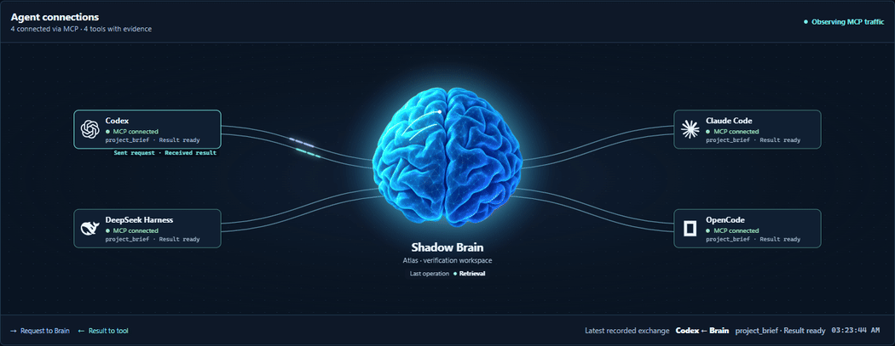
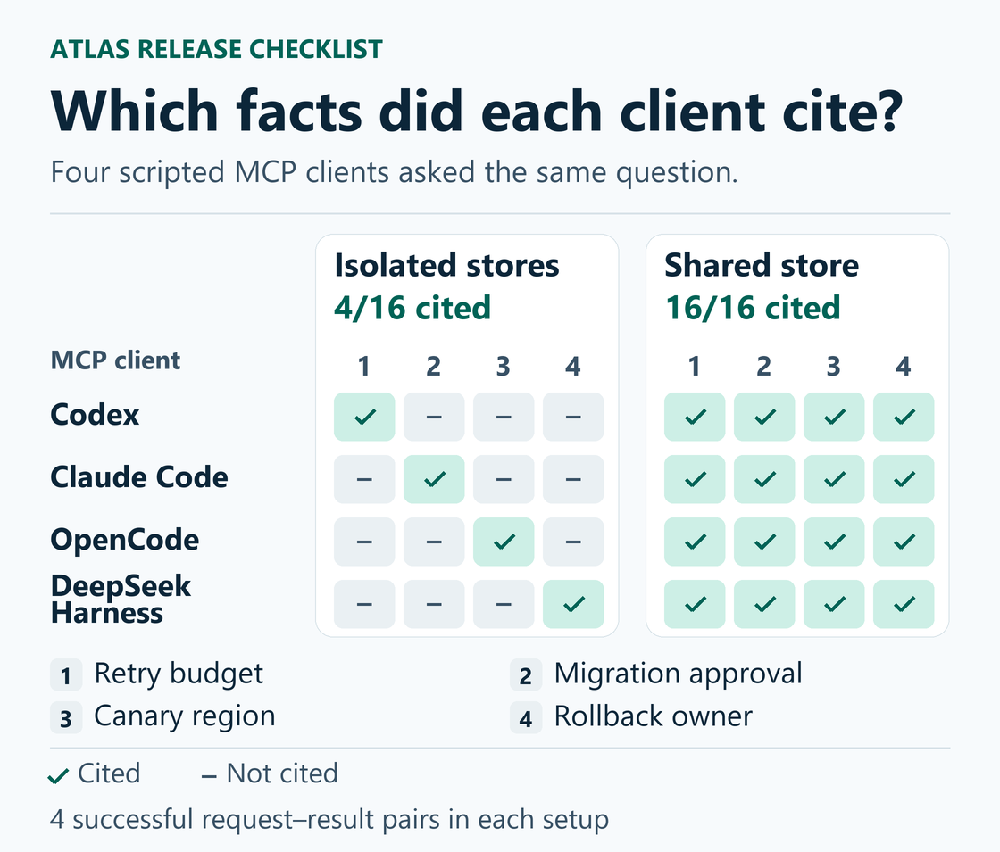
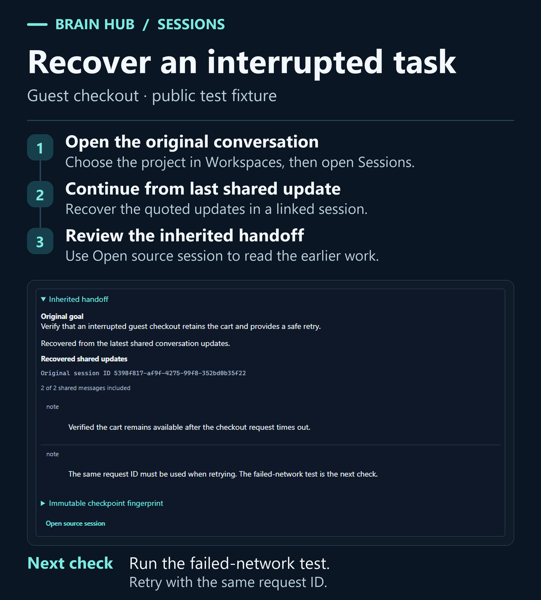
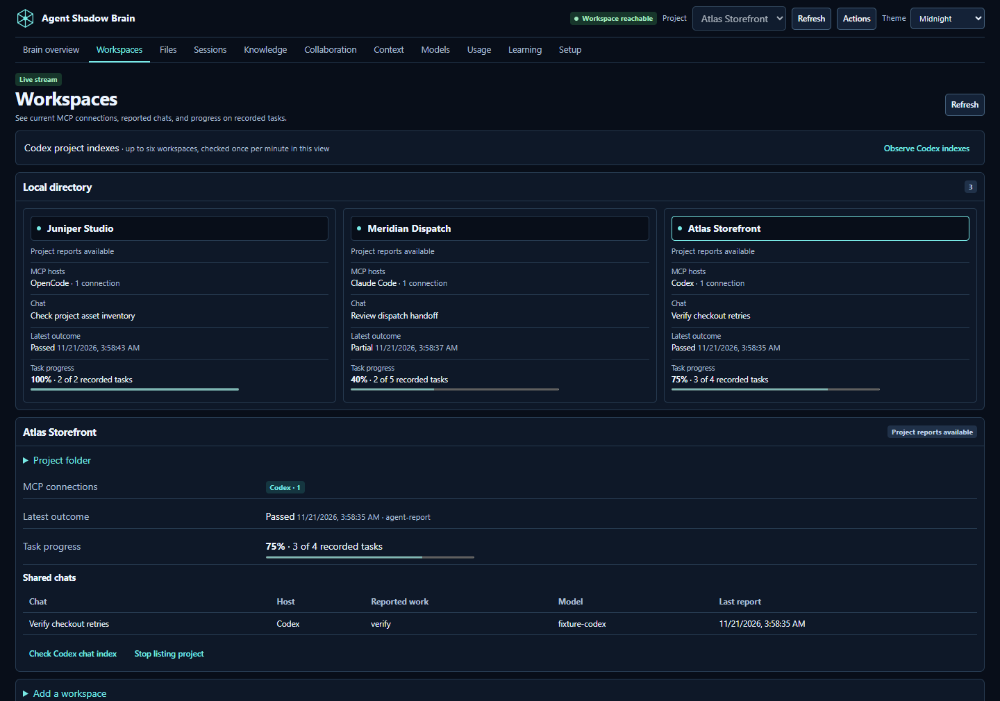
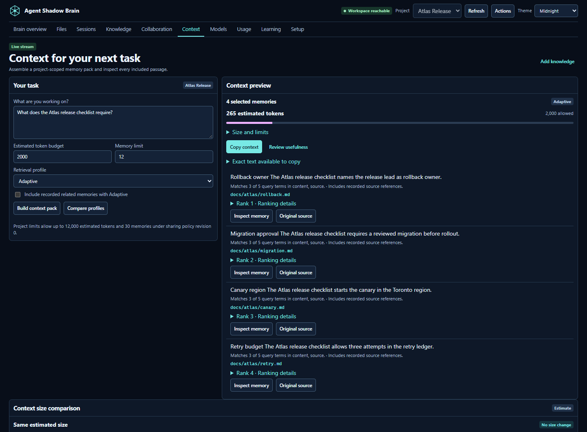

# Agent Shadow Brain

Pick up a task in a different coding agent without writing the handoff from scratch. Shadow Brain keeps the project’s decisions, source notes and unfinished work in a local store that your agents can share.

[](https://www.npmjs.com/package/@theihtisham/agent-shadow-brain) [](https://www.npmjs.com/package/@theihtisham/agent-shadow-brain) [](https://github.com/theihtishaam) [](https://github.com/theihtishaam/agents-brain)



*Recorded in the running dashboard with four scripted clients in a test project. Each moving signal corresponds to a tool request or result.*

## Try it

From the project folder, run this with Node.js 22.13 or later in the 22.x line, 24.x, or 26+.

```sh
npx --yes --package @theihtisham/agent-shadow-brain@7.25.0 shadow-brain project workspace . --port 62595
```

1. Open the [local Brain Hub](http://127.0.0.1:62595/hub) and keep the terminal running.
2. In **Knowledge**, enter “The checkout service retries a failed payment with the same request ID.” Choose **Add to memory**.
3. In **Context**, ask “Which request ID should a retry use?” Open the cited passage to see the original note.
4. In **Setup → Host connections**, connect a supported agent and reload it if prompted. Ask it to use `project_brief` to answer the same question. Connect a second agent to the same folder and it can read the same source.

You can start with a single sentence. The project keeps its data in `.shadow-brain` and reopens it the next time you start the portal in that folder. [Install options and quickstart](https://github.com/theihtishaam/agents-brain/blob/v7.25.0/docs/QUICKSTART.md)

## When a shared brain helps

| When you… | With separate chat histories | With Shadow Brain |
| --- | --- | --- |
| Switch tools midway through a fix | You find the last useful turn and explain what to try next. | The next agent can open a saved checkpoint with the goal, constraints, evidence and next step. |
| Revisit a decision weeks later | You search old threads for the wording. | A project brief returns the matching note with its source. You can inspect the original. |
| Work on several projects | You choose which details to paste into each new chat. | Each folder has its own memory, chat-sharing settings and context budget. |
| Learn something from a passing test | The result stays in the chat unless someone writes it down. | A reported outcome with evidence can draft a lesson. You review it before promoting it into retrieval. |

### What changed in a measured example?

Four scripted clients asked the same question about a release checklist. Each started with one of four facts. With separate stores, each reply cited its own fact. With the facts in one shared store, every reply cited all four. A citation counted only when the reply included the expected text, source and memory ID.



That’s **4 of 16 possible citations** across separate stores and **16 of 16** in the shared store. Both setups completed four tool calls. This experiment measures how much known evidence reached the clients. [Receipts](https://github.com/theihtishaam/agents-brain/blob/v7.25.0/docs/evaluation/SHARED_BRIEF_v7.25.0.json) · [Reproduce the comparison](https://github.com/theihtishaam/agents-brain/blob/v7.25.0/docs/VISUAL_GUIDE_v7.25.0.md#four-facts-two-setups)

We also ran both retrieval profiles against 14 cases, including identifiers, duplicate notes, excluded records and a tight context budget.

| Retrieval check | Legacy | Adaptive |
| --- | ---: | ---: |
| Cases passing every check | 6 / 14 | 14 / 14 |
| Mean fraction of relevant records in the first five results | 0.679 | 1.000 |
| Context-budget violations | 0 | 0 |

These results come from the included fixtures. Model answer quality, token bills and time saved depend on the task and host. [Case-by-case results and method](https://github.com/theihtishaam/agents-brain/blob/v7.25.0/docs/evaluation/CONTEXT_EVALUATION_v7.25.0.md)

## Continue where another agent stopped

Suppose you investigate a checkout failure in Codex and want to finish it in Claude Code. Ask Codex to save a checkpoint with the retry constraint, what it tested and the next failing case. In Claude Code, request the handoff for that task. The new session links back to the original, so you can check the earlier decision or take a different approach. **Copy handoff for any agent** also gives you a plain-text version.



If work stops before a checkpoint, **Continue from last shared update** can recover progress the host already shared. For word-for-word history, enable **Exact shared conversation history** and enroll a compatible chat. Codex also lets you follow a selected native conversation for the duration of its local connection. Detection alone gives the dashboard no access to an app’s private chats. [Capture, limits and handoffs](https://github.com/theihtishaam/agents-brain/blob/v7.25.0/docs/SESSIONS.md)

## Inside the Brain Hub



**Workspaces** shows which project a host reported to, its latest shared chat and any recorded outcomes. Open a workspace to browse its files, notes and sessions. On the brain graph, select a memory point to inspect its source or select a host to inspect recorded traffic.



**Context** shows what was selected for a brief and how much space it takes. **Usage** shows tokens when a host reports them. An empty token field means the host has supplied no measurement. [Dashboard tour](https://github.com/theihtishaam/agents-brain/blob/v7.25.0/docs/VISUAL_GUIDE_v7.25.0.md) · [Capabilities and limits](https://github.com/theihtishaam/agents-brain/blob/v7.25.0/docs/FEATURES_AND_LIMITS.md)

## Connect your agent

The local server speaks MCP (Model Context Protocol). Point participating clients at the same project directory. For Codex, the CLI can print the host’s configuration recipe:

```sh
shadow-brain project config . --target codex
```

Use the `shadow-brain` command after a global install, or run it through `npx` as above. Project setup is available for Codex, Claude Code, OpenCode and supported VS Code/Copilot and Kilo Code configurations. Cline, OpenClaw and DeepSeek Harness have manual recipes. The integration guide lists what each host can share and where approval or a restart is needed. [Host compatibility](https://github.com/theihtishaam/agents-brain/blob/v7.25.0/docs/INTEGRATIONS.md) · [Troubleshooting](https://github.com/theihtishaam/agents-brain/blob/v7.25.0/docs/TROUBLESHOOTING.md)

## Project and maintainer

I’m Ihtisham Ahmad. If Shadow Brain helped you pick up unfinished work, you can star the repository. If a handoff lost something important, open an issue with the host name and the step where it happened. [Star Agent Shadow Brain](https://github.com/theihtishaam/agents-brain) · [Report an issue](https://github.com/theihtishaam/agents-brain/issues) · [Follow me on GitHub](https://github.com/theihtishaam) · [LinkedIn](https://www.linkedin.com/in/ihtishamdeveloper/)

[All guides](https://github.com/theihtishaam/agents-brain/blob/v7.25.0/docs/README.md) · [Release notes](https://github.com/theihtishaam/agents-brain/blob/v7.25.0/docs/launch/RELEASE_NOTES_v7.25.0.md) · [Downloads and coverage](https://github.com/theihtishaam/agents-brain/blob/v7.25.0/docs/STATS.md) · [MIT license](https://github.com/theihtishaam/agents-brain/blob/v7.25.0/LICENSE)
