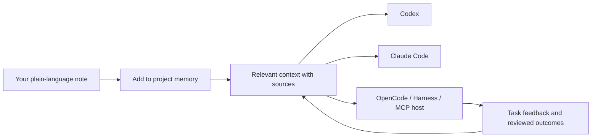
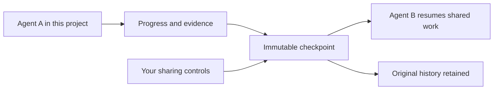
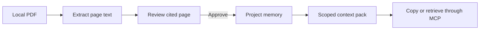
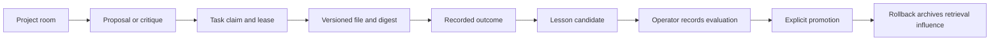

<h1 align="center">Agent Shadow Brain</h1>

[](https://github.com/theihtishaam)
<p align="center"><strong>Your project memory. Shared across your AI tools.</strong></p>
<p align="center">Save a fact once. Find useful context. Hand off work with its evidence intact.</p>

<p align="center">
  <a href="https://www.npmjs.com/package/@theihtisham/agent-shadow-brain"></a>
  <a href="https://github.com/theihtishaam/agents-brain/actions/workflows/ci.yml"></a>
  <a href="LICENSE"></a>
  <a href="https://github.com/theihtishaam/agents-brain/stargazers"></a>
</p>

<!-- NPM_TOTAL_START -->
**Total npm downloads: 6,229** · Through **2026-11-13**. [npm data](https://github.com/theihtishaam/agents-brain/blob/main/docs/npm-metrics.json).

GitHub refreshes this number every two days. The npm README records the total when this version was published. Downloads include automated installs; they are not unique users.
<!-- NPM_TOTAL_END -->

<p align="center"><a href="#try-it">Try it</a> · <a href="#inside-the-brain-hub">Visual tour</a> · <a href="#connect-your-agent">Connect your agent</a> · <a href="docs/README.md">Documentation</a></p>


[What works and its limits](docs/FEATURES_AND_LIMITS.md)

The Brain Hub brings reviewed notes, cited documents, shared work, and recorded tool activity into one local workspace. This recording uses an isolated synthetic test project: 580 stored memories, a bounded graph view, and real MCP calls from scripted clients. It does not show a model's private thoughts or a customer's activity. [Visual guide](docs/VISUAL_GUIDE_v7.22.0.md) · [Research and release plan](docs/launch/RESEARCH_AND_PLAN_v7.22.0.md)

## Try it

Use **Node.js 22.13+ in the 22.x line, 24.x, or 26+**. From your project directory, one command installs the requested version in npm's cache and starts its local portal:

```bash
npx --yes --package @theihtisham/agent-shadow-brain@7.22.0 shadow-brain project workspace . --port 62595
```

For a reusable global command:

```bash
npm install -g @theihtisham/agent-shadow-brain@latest
shadow-brain --version
cd your-project
shadow-brain project workspace . --port 62595
```

Keep the launcher running and open [the project Brain Hub](http://127.0.0.1:62595/hub). Start with **Knowledge → Add to memory**, then **Context → Find useful context**. Connect your chosen tool through **Setup** when you want it to retrieve that memory. Use the same project directory and port when restarting. Port `0` lets the OS assign a free port; open the URL printed by that launch.

To build from this checkout while preparing a release, use `npm ci`, `npm run build`, then `node dist/cli.js project workspace . --port 62595`. The command’s directory argument selects which project store to open. [Quickstart](docs/QUICKSTART.md) · [Troubleshooting](docs/TROUBLESHOOTING.md)

## Inside the Brain Hub


| View | What you can do |
| --- | --- |
| **Brain overview** | Recognize your tools by their icons, inspect reported agents and models, follow stored memory relationships, and seek through recorded activity. An empty store has zero graph nodes and edges. |
| **Knowledge** | Paste ordinary text and click Add to memory. Review longer notes, inspect original sources, or optionally import a document. Generate a project-specific skill. |
| **Sessions** | Inspect reported work, original conversation snapshots, saved checkpoints and linked continuations. Connect the supported Codex history API explicitly or select an export from another tool. |
| **Collaboration** | Open a project room, post a proposal or critique, claim a task, attach a project file, accept evidence, and record the outcome. |
| **Context** | Assemble a scoped pack, inspect selected passages and sources, compare retrieval profiles, and copy the rendered Markdown. |
| **Models and Usage** | Inspect client readiness, retained exchanges and optional host-reported model/token receipts. Unknown counts remain unknown; costs are not invented. |
| **Learning** | Rate memories for a task, pause or remove retrieval feedback, and create a lesson from a recorded outcome. Record a paired evaluation, promote an eligible lesson, or roll back its retrieval influence. |
| **Setup** | Choose tool participation, chat sharing, context limits and coordination roles. Manage features and verified Project Kit skills. |

### See which tool reported the work


The tool activity panel uses local Codex/OpenAI, Claude, DeepSeek and OpenCode icons. Hover, focus or select a tool to inspect its project, recorded conversations, coordination role, latest observed action and optional model receipts. Separate conversations stay identifiable when one tool has several workers.

Model, provider, effort and token counts come from explicit host reports. Missing values say **Not reported**. Activity indicators respond to new recorded events, respect **Pause motion** and reduced-motion preferences, and do not animate old history as new work. The icon identifies the tool, not the model it may be running.

**Reporting MCP connections** counts initialized project connections with a current heartbeat. Connections renew every ten seconds and expire after thirty seconds without renewal. This reports the memory transport; a connected tool may be idle. It does not count native apps that have not connected to this project.

The panel captures use four scripted MCP clients and synthetic model receipts. They demonstrate the working interface and transport, not four native applications or model inference.

[Activity and session guide](docs/SESSIONS.md) · [Icon sources and license](docs/BRAND_ASSETS.md)

### Start with ordinary words


1. Open **Knowledge** and type: **“The cupboard is black. Keep its brass handles.”**
2. Click **Add to memory**. The note and its original wording are saved in this project.
3. Open **Context** and ask: **“What colour is the cupboard?”** Inspect the returned note and its source. A connected agent can request the same context through MCP.
4. For longer notes or edits before saving, choose **Review first**, then save the useful parts. Pending and skipped parts stay outside shared retrieval.
5. Use **Learning** to mark a memory useful, irrelevant or incorrect for a task, then inspect the effect on the next retrieval.

Direct notes support up to 6,000 characters and 20 paragraphs. No PDF, JSON or special format is required. The brain stores reference knowledge; your agent handles reasoning and answers from the context it requests. [Notes and conversation import guide](docs/SOURCE_INTAKE.md)



### Continue where another agent stopped


An agent records meaningful progress and saves a checkpoint: what is done, decisions, evidence and next steps. Another connected agent calls `session_resume` with that checkpoint's ID and digest. It receives the exact saved handoff in a new linked session; the original remains available. This transfers recorded work, not hidden model state or an application's native running process.

**Original tool history** preserves names and conversation IDs supplied by supported sources. Codex has an explicit read-only connection to its installed app-server's project index; Claude Code, OpenCode and DeepSeek Harness support selected native exports. Missing original names remain unavailable. A saved history page is a bounded snapshot, and an operator adds a checkpoint before handing it to another agent. [Sessions and native formats](docs/SESSIONS.md)



### Follow evidence from a PDF to a context pack




The project store records the document fingerprint and the approved page citation. An image-only page shows that OCR is needed. Context budget figures estimate rendered pack tokens, and profile comparisons use the same scoped request. Optional host-reported token receipts appear separately in Usage. Context estimates do not prove a billing reduction. [Context guide](docs/CONTEXT_LAB.md)

### Coordinate work and record a lesson



Browser and compatible project-local MCP clients share the same room records. Task claims carry revisions and expire. A recipient acknowledgement references the specific message or artifact. Learning changes project memory and retrieval. The workspace does not run models, train them, or assign work to hosts by itself. [Workspace guide](docs/WORKSPACE.md) · [Workflow integration](docs/WORKFLOW_INTEGRATION.md)


### Browse the original evidence tools

The classic workspace offers memory curation, typed relationships, retrieval feedback, and the full Context Lab. The detailed activity view adds filters and playback controls for the loaded journal.


## Connect your agent

Generate a recipe from the same directory used to start the project workspace. The recipe identifies the project store and launches the local stdio service.

```bash
shadow-brain project config . --target codex
shadow-brain skills install . --target codex
```

Preview the skill installation before adding `--apply`. Merge the printed recipe in the selected host, reconnect, and confirm it can list and call a tool such as `project_inspect` or `context_pack`. A recorded exchange will appear when activity recording and display are enabled. [Integration guide](docs/INTEGRATIONS.md)

| Target | Recipe |
| --- | --- |
| Codex | `shadow-brain project config . --target codex` |
| Claude Code | `shadow-brain project config . --target claude-code` |
| OpenCode | `shadow-brain project config . --target opencode` |
| DeepSeek Harness | `shadow-brain project config . --target deepseek-harness` |
| Other compatible host | `shadow-brain project config . --target portable` |

The Setup page distinguishes installed files, configuration recipes, observed calls and host-reported usage. Tools must connect and request context; installing a package cannot make every application use it automatically. The Codex history adapter completed a real 0.145.0 handshake and an empty-project indexed list. History paging and imports were verified against controlled process fixtures; no personal native history was read for release testing.


### Keep the workspace under your control

Set context token and entry ceilings, turn features on or off, and choose which conversations can be delivered to connected agents. Explicit source links carry those exclusions into retrieval and inherited handoffs. Tool switches use the client label supplied by a cooperating host; they are not authenticated access control. Already delivered context cannot be withdrawn from another application.

Enable **project file activity** only when you want file-change metadata. The live stream sends bounded change notifications; it does not repeatedly reload the whole dashboard. File events identify paths and times, while agent attribution requires an actual report. [Measured local performance and limits](docs/WORKSPACE.md)

The dashboard separates **reported model tokens**, **estimated context reduction**, and **measured tool duration**. It never converts a smaller context pack into a claimed billing or speed saving.

## Documentation

- [Quickstart](docs/QUICKSTART.md) · [Workspace guide](docs/WORKSPACE.md) · [Visual guide](docs/VISUAL_GUIDE_v7.22.0.md) · [Features and limits](docs/FEATURES_AND_LIMITS.md)
- [Project Kit](docs/PROJECT_KIT.md) · [Context Lab](docs/CONTEXT_LAB.md) · [Workflow skills](docs/WORKFLOW_INTEGRATION.md)
- [Integrations](docs/INTEGRATIONS.md) · [Sessions](docs/SESSIONS.md) · [Troubleshooting](docs/TROUBLESHOOTING.md) · [Release notes](docs/launch/RELEASE_NOTES_v7.22.0.md)

MIT license. [Changelog](CHANGELOG.md)
