<h1 align="center">Agent Shadow Brain</h1>
<p align="center"><strong>A shared brain for the tools you build with.</strong></p>
<p align="center">Keep project knowledge, understand context, and follow the work between your AI tools.</p>

<p align="center">
  <a href="https://www.npmjs.com/package/@theihtisham/agent-shadow-brain"></a>
  <a href="https://www.npmjs.com/package/@theihtisham/agent-shadow-brain"></a>
  <a href="docs/STATS.md"></a>
  <a href="https://github.com/theihtishaam/agents-brain/actions/workflows/ci.yml"></a>
  <a href="LICENSE"></a>
  <a href="https://github.com/theihtishaam/agents-brain/stargazers"></a>
</p>

<p align="center"><a href="#try-it">Try it</a> · <a href="#visual-direction">Visual tour</a> · <a href="#connect-your-agent">Connect your agent</a> · <a href="#where-it-fits">Compare approaches</a> · <a href="docs/README.md">Documentation</a></p>

[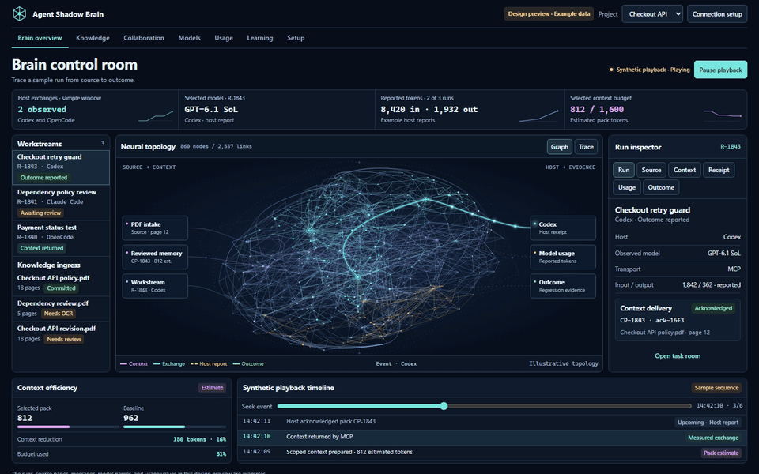](docs/VISUAL_GUIDE_v7.1.4.md)

**7.1.4 is in development.** The animation above is the proposed control room, using example data. The shared-work, PDF intake and evaluated-learning flows below are design targets. The existing context and memory tools are available in the development checkout. npm `latest` is **7.1.3**, checked November 13, 2026; 7.1.4 has not been published.

## Visual direction

[Download the standalone interactive design](docs/previews/control-room.html) and open the HTML file in your browser. It runs offline with example data; no agent connection is required.

The new control room brings sources, context, connected tools and outcomes into one view. A dense network gives you the overview; selecting a route opens the evidence behind it.

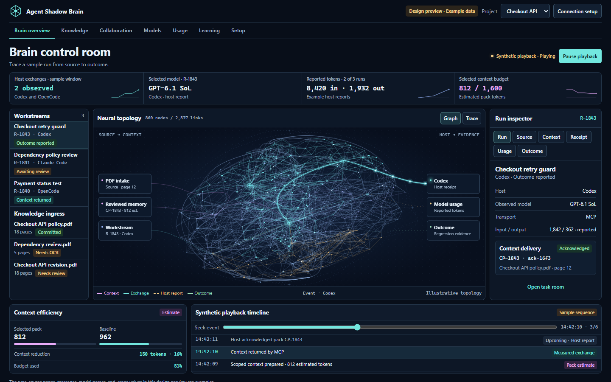

| Part of the screen | What it explains |
| --- | --- |
| **Knowledge entering** | Which document, note or project observation supplied the evidence. |
| **Shared brain** | How the selected context relates to sources and connected hosts. The fine background topology is conceptual. |
| **Agent routes** | Where a context pack or handoff goes, and which receipt exists. |
| **Selected run** | The host, reported model, sources, usage and outcome for one operation. |
| **Usage and timeline** | Reported counts, estimated pack size, a named comparison, and the sequence of events. |

The preview supports focus, pause and replay. Its motion is synthetic playback, not evidence of a running model. Production routes must be driven by recorded exchanges. [Walk through every screen](docs/VISUAL_GUIDE_v7.1.4.md).

### The connected workflow

This diagram describes the **planned shared Brain Hub**. Scoped context assembly and project-local skill generation already provide part of its foundation; the complete collaboration and learning loop is still to be built.

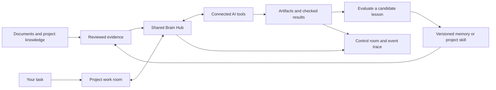

### From a document to useful context

The proposed intake flow keeps the original page beside the extracted passage. Approved evidence can then be cited in a context pack. Image-only pages need an OCR-capable worker; they must never appear as successfully indexed empty text.

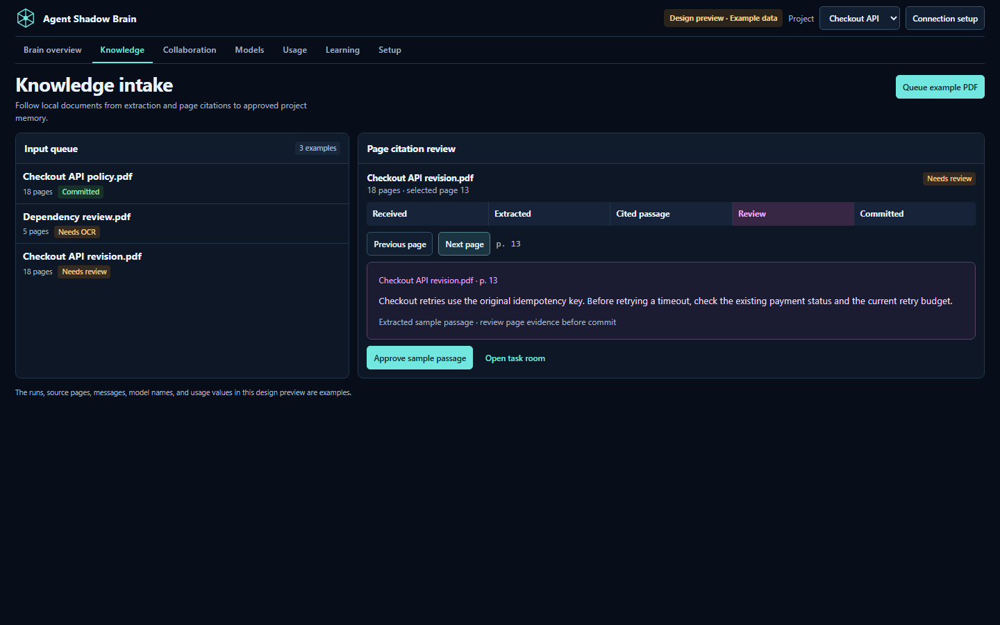

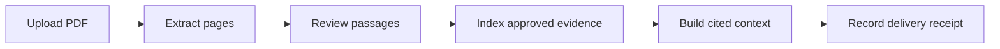

*Design preview with example passages. PDF extraction is planned; this image does not demonstrate a working parser.*

### Let agents share the work

The proposed room keeps a plan, critique, task claim, artifact and handoff together. The recipient acknowledges the same artifact or pack ID, so a sent message and accepted work remain distinct.

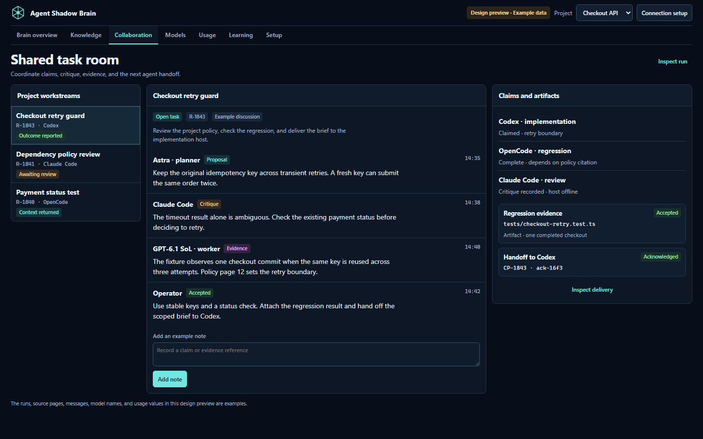

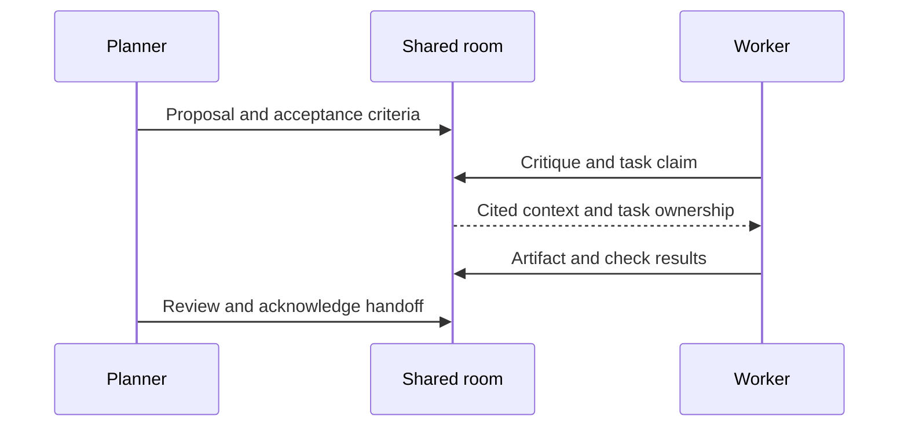

*Proposed collaboration flow. Generic MCP access does not itself launch or supervise a native coding agent.*

### See what changed on the next attempt

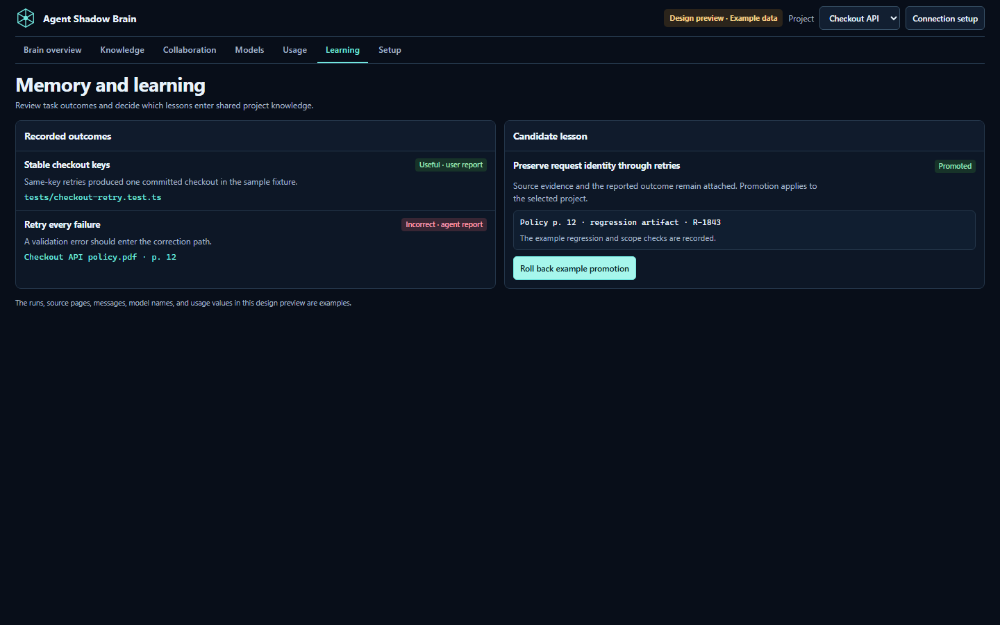

Today, project feedback can make a bounded, reversible ranking adjustment on relevant tasks. The planned extension evaluates candidate lessons on separate tasks before promoting a versioned memory or skill. A useful change must improve a checked result while preserving unrelated behavior. [Learning design and its limits](docs/VISUAL_GUIDE_v7.1.4.md#learning-and-skills).

<details>
<summary><strong>Explore model, usage and setup designs</strong></summary>

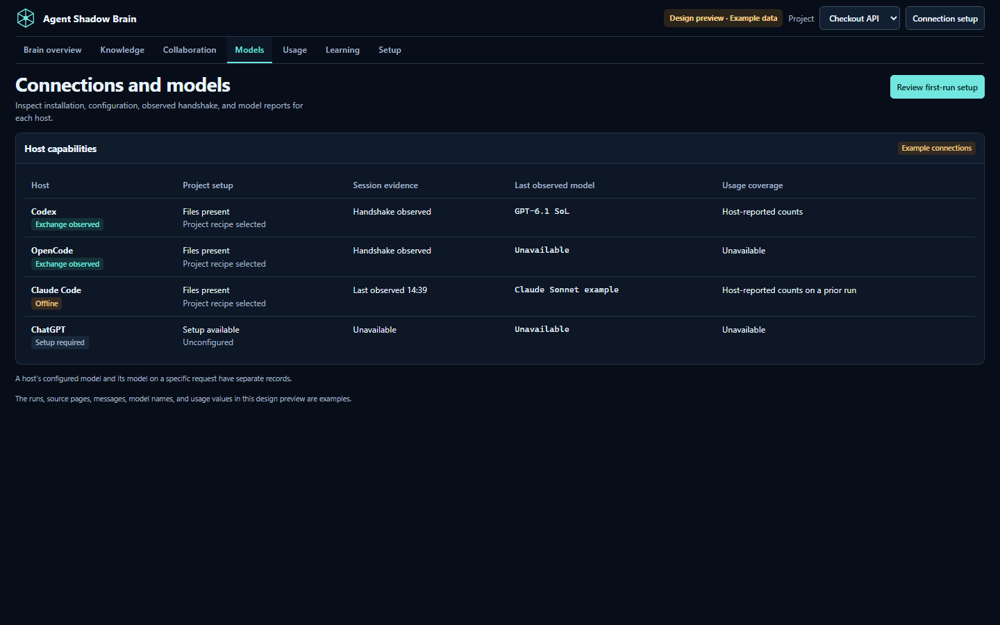

*Configuration, handshake, activity and model reports have separate meanings.*

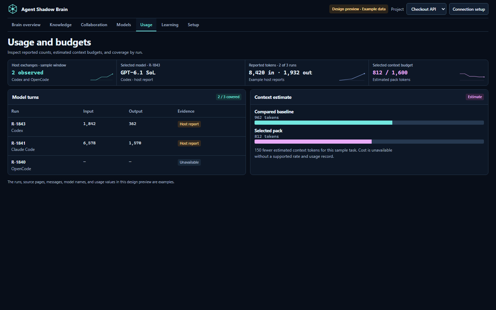

*Reported tokens and estimated context reduction stay separate. An unavailable metric stays unavailable.*

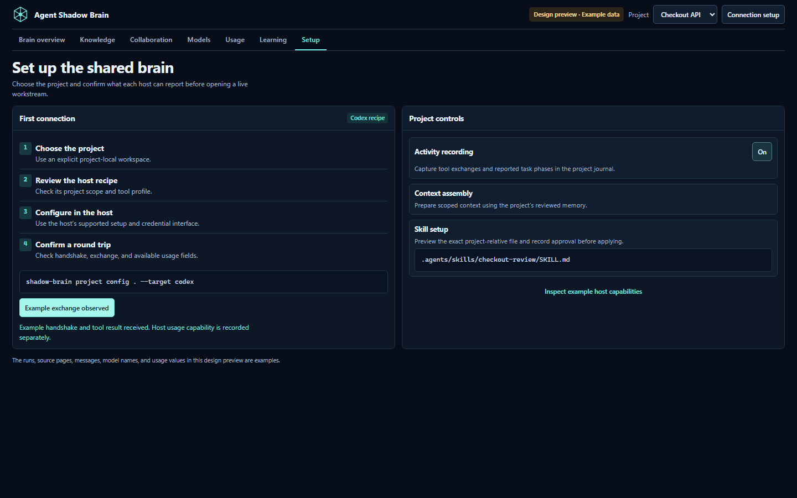

*A setup file prepares a connection. A successful host exchange verifies it.*

</details>

## Try it

Use Node.js **22.12+ in the 22.x line, 24.x, or 26+**.

Install the published package:

```bash
npm install -g @theihtisham/agent-shadow-brain@latest
shadow-brain --version
```

To explore the **7.1.4 development workspace**, build a source checkout:

```bash
git clone https://github.com/theihtishaam/agents-brain.git
cd agents-brain
npm ci
npm run build
node dist/cli.js demo workspace
```

The source demo is the existing memory workspace. The dense control room above is a separate design preview.

Open the printed address. You get two example projects, reviewed memories, recorded relationships, working controls, and live scripted calls. Everything in this tour stays in a temporary store. **Ctrl+C** stops the server and removes that demo. Add `--no-activity` to inspect its initial recorded snapshot.

For your own project, run the built development CLI with an explicit project path:

```bash
node dist/cli.js project workspace /path/to/your/project
node dist/cli.js project config /path/to/your/project --target codex
```

On Windows, quote the full project path. To use the shorter `shadow-brain` commands in the later development examples, run `npm link` from this checkout; it replaces the global command binding with this checkout. Keep using `node dist/cli.js` if you prefer not to change that binding.

Open **Project Kit**, add a useful rule or lesson, then describe the task and preview a project-specific skill. The recipe connects your coding tool to that same local store. [The walkthrough](docs/PROJECT_KIT.md) covers the complete flow. Existing shared-store users can continue with `shadow-brain dash . --no-analysis`.

Use the `latest` tag for the published build. An older publication named 7.2.0 exists, so semantic version order differs from the maintained tag. The 7.1.4 development release remains held; a Windows project-path CI failure is still unresolved.

## Implemented in the development checkout

| Improvement | What it helps you do |
| --- | --- |
| **Project Kit** | Inspect observed project markers, add your knowledge, and generate a task-specific skill inside the selected project. |
| **Learning from outcomes** | Record what helped or failed, inspect its limited effect on related future tasks, and remove or disable that influence. |
| **Adaptive retrieval** | Match technical terms, whole code identifiers, paths, source references, categories, and tags without a model call. |
| **Relevant passages** | Read the passage around the match, including a useful hit deep inside a memory. |
| **Duplicate handling** | Combine exact normalized duplicates before the candidate cap and retain recorded source provenance. |
| **Recorded-link expansion** | Include a small one-hop set of supporting or related memories, with the exact recorded path shown. |
| **Context Lab** | Inspect the retrieval stages, ranking signals, selected and excluded candidates, and estimated output budget. |
| **Profile comparison** | Compare adaptive and legacy packs against the same memory view before choosing what to hand to an agent. |
| **Memory attention queue** | Find contested records, recorded contradictions, missing references, duplicate text, older notes, and unavailable link endpoints. |
| **Graph inspection** | Focus on recorded relationships, inspect a connected neighborhood, and open the underlying memory. |
| **Recorded replay** | Freeze the retained activity snapshot, scrub through events, and filter the recorded transport. |
| **MCP discovery** | Use focused memory-inspection tools, resources, and optional task/handoff prompt templates. |
| **Setup recipes** | Generate native-format configuration examples for Codex, Claude Code, OpenCode, DeepSeek Harness, and compatible hosts. |
| **Fresh briefings** | Invalidate session context when another process commits memory or the current process stages a new record. |
| **Isolated tour** | Explore the real workspace with `demo workspace`, without a model provider or your existing memory store. |

The established retrieval profile and automatic briefing behavior remain available. SDK, CLI, and MCP calls keep **legacy** retrieval unless `profile: "adaptive"` is requested. Context Lab selects adaptive explicitly. Existing analysis modules, adapters, and advanced dashboards are retained. [Release notes](docs/launch/RELEASE_NOTES_v7.1.4.md) · [Component catalog](docs/COMPONENTS.md)

## Current workspace tour

These captures show the existing development workspace with synthetic fixtures. They document the working foundation beneath the planned redesign.

<details>
<summary><strong>Open the step-by-step workspace tour — 12 screenshots</strong></summary>

### Your project, its knowledge, its skills

Project Kit recognizes bounded manifest and directory evidence, shows declared checks, and combines those observations with your requirement. A generated skill stays in the chosen host's project folder. Preview shows the exact file; Apply checks ownership and refuses to overwrite an edited or unowned skill.


After a real task, report whether a selected memory helped. User and agent reports remain separate. Matching reports can make a small, visible adjustment to future adaptive ranking; they cannot create a match or revive an inactive memory. Repeated identical praise does not accumulate. Turn influence off or remove a report at any time.


This is learning through reported outcomes, not model-weight training or automatic proof of correctness. [How learning works](docs/LEARNING.md)

### 1. Start with the memory overview

Choose a project and see what is available. Source coverage means a reference was recorded; it does not mean the referenced claim was verified. The attention queue leads directly to the memory that needs review.


### 2. Build context for an actual task

Open **Context Lab**, select the project, write the task, choose a budget, and build the pack. Inspect matching fields, ranking signals, and exclusions. Switch recorded-link expansion off when you only want direct matches. Copy or download the selected Markdown to hand it to another tool.


### 3. Compare before you rely on it

Use the comparison action to see added, removed, and shared memory IDs between the two profiles. Both use one memory view. Their token estimators differ, so a different selection alone does not establish better accuracy.


### 4. Follow the recorded relationships

Open **Graph** and select a memory. The inspector distinguishes project membership, recording agent, and explicitly recorded `supports`, `related`, `contradicts`, or `supersedes` links. These edges describe saved relationships, not hidden model thoughts.


Open a memory to review its content and references. Mark an outdated note archived, a disputed note contested, or record its relationship to a replacement. These changes use revisions to prevent overwriting someone else's newer review. Inactive memories stay out of context packs.


### 5. Connect a coding tool

The **Integrations** screen shows supported capabilities, installed project skill files, diagnostics, and a copyable configuration recipe. A configuration example or a found skill file is not a live connection. Confirm a successful tool call in your host.


### 6. Inspect live calls and replay a snapshot

Open **Live** for recorded sessions, tool spans, outcomes, and explicit host-reported phases. Filter by source or transport. Replay works on the retained snapshot so you can stop at an event and inspect what was recorded. Activity retention is bounded to the latest 500 events.


### 7. Keep control of the system

Five persisted switches control context packs, cross-project context, automatic briefings, live delivery, and activity recording. Turning off live delivery does not turn off recording. Theme and reduced motion are separate display preferences.


<details>
<summary>See the mobile workspace</summary>


</details>

[Detailed Context Lab guide](docs/CONTEXT_LAB.md) · [All screenshots](docs/SHOWCASE.md) · [Workspace and API reference](docs/WORKSPACE.md)

</details>

## Connect your agent

Print a recipe for your host and selected project. This command prints configuration; it does not inspect or edit existing client settings.

```bash
shadow-brain project config . --target codex
shadow-brain clients inspect .
```

| Host | Recipe target | Project skills |
| --- | --- | --- |
| Codex | `codex` | `.agents/skills/` |
| Claude Code | `claude-code` | `.claude/skills/` |
| OpenCode V2 | `opencode` | `.opencode/skills/` |
| DeepSeek Harness | `deepseek-harness` | `.dsh/skills/` |
| Other compatible hosts | `portable` | `.agents/skills/` |

Preview and install focused workflow guidance:

```bash
shadow-brain skills list
shadow-brain skills install . --target codex
shadow-brain skills install . --target codex --apply
```

The six bundled skills cover task selection, implementation, debugging, review, research, and release. They ask the executing agent to use proportionate planning and relevant evidence. They do not grant permissions, run background tasks, or make every simple request a long workflow.

The standalone server runs as `shadow-brain mcp --stdio`. Useful calls are:

- `context_pack`: project context, profile choice, budget, provenance, and selection decisions.
- `memory_inspect`: bounded detail for an explicitly selected project and memory ID.
- `memory_health`: a scoped review queue and coverage counters.
- `workflow_analyze` / `workflow_skills`: task guidance and selected skill content.
- `activity_report`: explicit bounded host events, labeled as reported.

MCP resources expose the usage guide, skill catalog, and an explicitly scoped memory URI. `shadow-task` and `shadow-handoff` prepare user-selected prompts in compatible hosts. DeepSeek Harness's documented bridge supports tools and resources but not MCP prompt templates. [Full connection instructions and limits](docs/INTEGRATIONS.md)

The project-local launch also exposes `project_inspect`, `project_knowledge`, `project_skill_preview`, `project_skill_apply`, and `project_feedback`. These tools use the pinned project and local store. Feedback from MCP is labelled as agent-reported; the host must observe the outcome before reporting it.

## How context works today

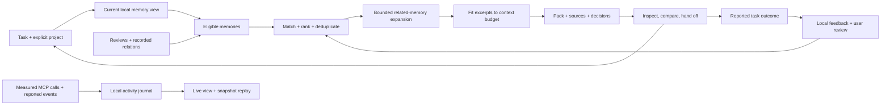

Memory content, annotations, feature settings, feedback, and activity live in separate local files. Project Kit uses `.shadow-brain/project-memory.json` inside your project. Existing shared-store commands use `~/.shadow-brain/global.json`; the isolated tour uses a temporary directory. Inspections refresh their read view without flushing staged memory writes. Stored source references are displayed, not automatically opened.

Adaptive retrieval scans the eligible corpus, recognizes technical terms and recorded fields, merges exact normalized duplicates, and ranks candidates with transparent lexical and heuristic signals. At most 200 distinct candidates reach selection; graph expansion is limited to one hop, 16 added candidates globally and two per seed. Matching examines up to 128,000 characters per memory and reports truncation. Output budgets include rendered labels and references. **Token counts remain estimates.** [Implementation and limits](docs/CONTEXT_LAB.md)

## Where it fits

Choose Shadow Brain when you want to inspect local project memory, understand its selection, and move bounded context between coding tools without requiring an embedding service or model provider for that path.

Other tools have useful strengths: Mem0 offers managed memory extraction and semantic retrieval, Letta integrates stateful agent memory with execution, and Graphiti emphasizes temporal graph relationships. Shadow Brain's lexical profile does not provide general semantic paraphrase retrieval or determine factual truth. [Dated, source-backed comparison](docs/COMPARISON.md)

The included diagnostic suite runs both profiles against **14 author-generated cases**. Adaptive passes 14 and legacy passes 6; both pass the suite's scope and budget checks. Those cases target the documented defects and boundaries. They do **not** measure model answer quality or establish superiority over competing products.

From a source checkout:

```bash
npm run build
npm run test:context-eval
```

[Evaluation results](docs/evaluation/CONTEXT_EVALUATION_v7.1.4.md) · [Raw results](docs/evaluation/CONTEXT_EVALUATION_v7.1.4.json) · [Brain Hub visual plan](docs/VISUAL_GUIDE_v7.1.4.md) · [Earlier retrieval research](docs/launch/RESEARCH_AND_PLAN_v7.1.4.md)

## Documentation and package details

| Guide | What you will find |
| --- | --- |
| [Visual guide](docs/VISUAL_GUIDE_v7.1.4.md) | Screen tour, graph legend, workflows and current versus planned behavior |
| [Quickstart](docs/QUICKSTART.md) | Install, run the isolated tour, save a first memory, build context |
| [Project Kit](docs/PROJECT_KIT.md) | Local knowledge, observed stack, tailored skills, matching MCP setup |
| [Learning](docs/LEARNING.md) | Reported outcomes, task relevance, ranking influence, reversal and limits |
| [Context Lab](docs/CONTEXT_LAB.md) | Retrieval stages, explanations, comparison, budgets, limitations |
| [Workspace](docs/WORKSPACE.md) | Review and graph operations, live events, local API, controls |
| [Integrations](docs/INTEGRATIONS.md) | Host recipes, skills, MCP tools/resources/prompts, verification |
| [Components](docs/COMPONENTS.md) | System responsibilities and retained advanced modules |
| [Comparison](docs/COMPARISON.md) | Where different memory approaches fit |
| [Troubleshooting](docs/TROUBLESHOOTING.md) | Empty results, storage errors, connections, stale views |
| [Release notes](docs/launch/RELEASE_NOTES_v7.1.4.md) | Changes, compatibility, and release boundaries |

Package: [`@theihtisham/agent-shadow-brain`](https://www.npmjs.com/package/@theihtisham/agent-shadow-brain) · Commands: `shadow-brain` / `asb` · Development version: **7.1.4** · License: **MIT**. The package installs without a postinstall script. Total downloads are computed from npm's public counts with recorded coverage dates; they are not unique users. [Metrics methodology](docs/STATS.md)

Maintained by [ihtishaam-dev](https://github.com/ihtishaam-dev) and [theihtishaam](https://github.com/theihtishaam). [Report a reproducible issue](https://github.com/theihtishaam/agents-brain/issues) or [read the contribution guide](CONTRIBUTING.md).
