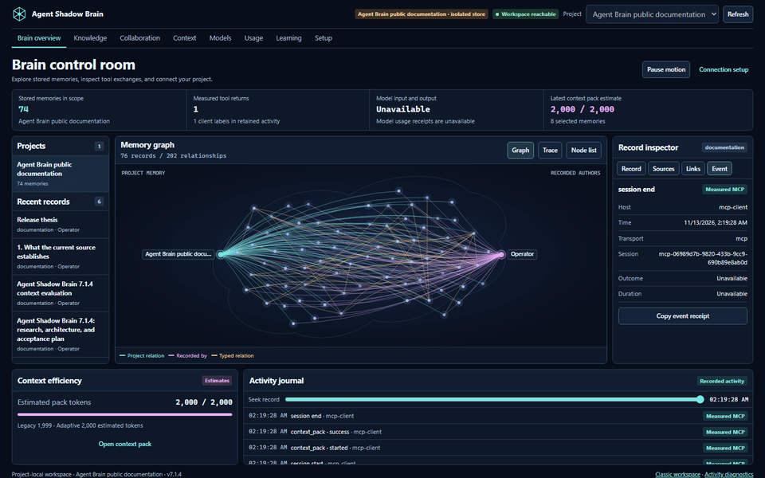
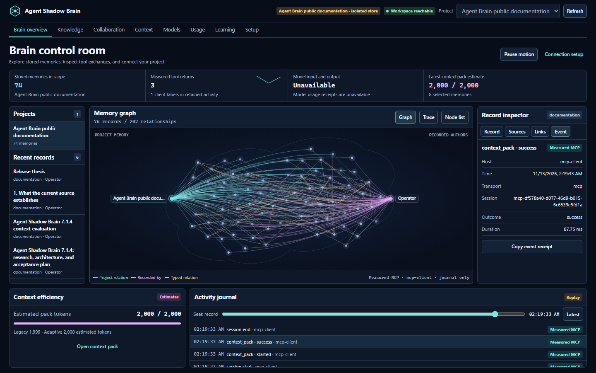
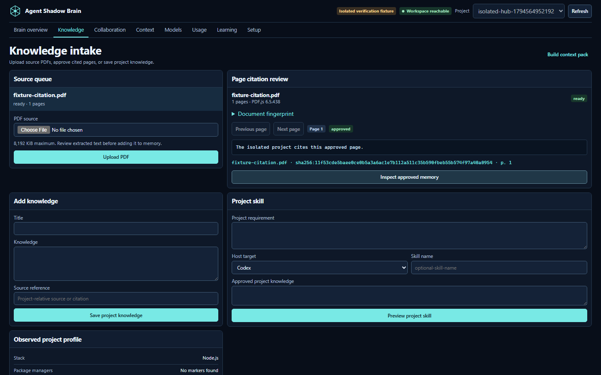
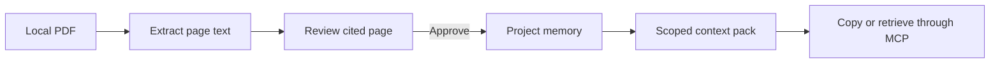
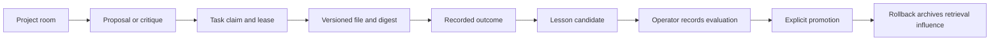
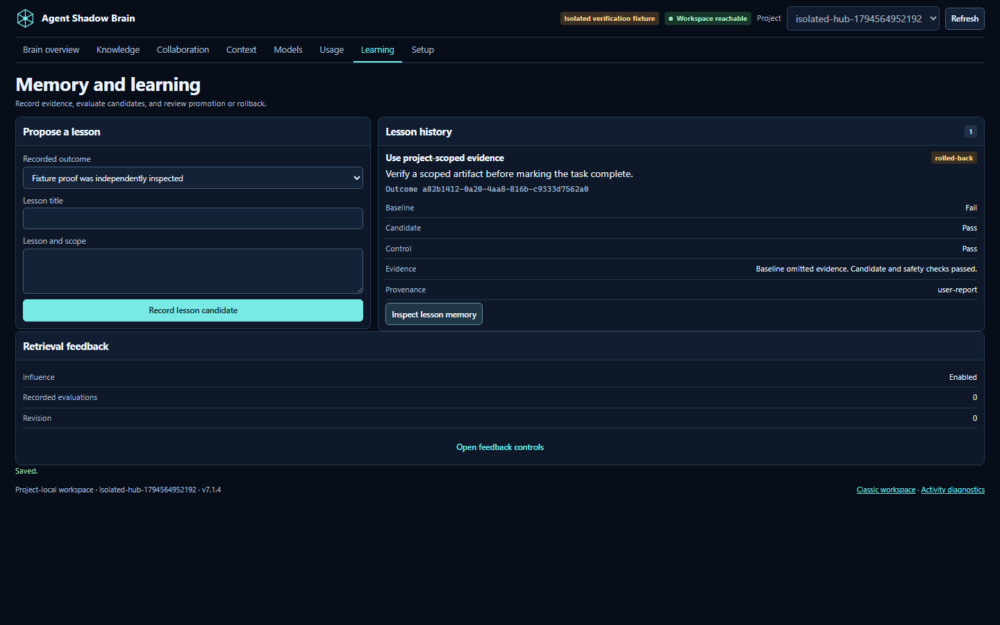
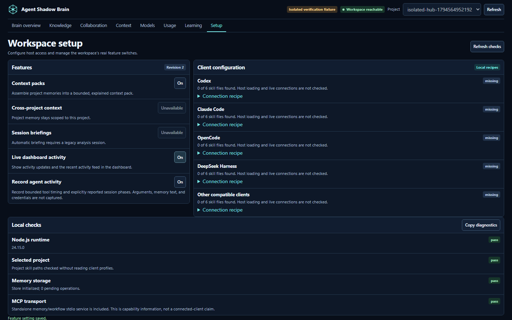

<h1 align="center">Agent Shadow Brain</h1>
<p align="center"><strong>A shared brain for the tools you build with.</strong></p>
<p align="center">Keep project knowledge, understand context, and follow the work between your AI tools.</p>

<p align="center">
  <a href="https://www.npmjs.com/package/@theihtisham/agent-shadow-brain"></a>
  <a href="https://www.npmjs.com/package/@theihtisham/agent-shadow-brain"></a>
  <a href="docs/STATS.md"></a>
  <a href="https://github.com/theihtishaam/agents-brain/actions/workflows/ci.yml"></a>
  <a href="LICENSE"></a>
  <a href="https://github.com/theihtishaam/agents-brain/stargazers"></a>
</p>

<p align="center"><a href="#try-it">Try it</a> · <a href="#inside-the-brain-hub">Visual tour</a> · <a href="#connect-your-agent">Connect your agent</a> · <a href="docs/README.md">Documentation</a></p>

[](docs/VISUAL_GUIDE_v7.1.4.md)

[Watch or download the 10-second MP4](https://github.com/theihtishaam/agents-brain/raw/refs/heads/main/docs/assets/7.1.4-hub-public-docs.mp4) · [What works and its limits](docs/FEATURES_AND_LIMITS.md)

The Brain Hub brings project memory, cited PDF pages, shared work, and recorded tool activity into one local workspace. The animation shows 74 excerpts from 18 public Agent Brain documents loaded into an isolated store. The activity journal records three actual local MCP calls from a scripted client. [Public documentation snapshot](https://github.com/theihtishaam/agents-brain/tree/2e26e7b349db4dd75bf0277b28caff8044190d16) · [Visual guide](docs/VISUAL_GUIDE_v7.1.4.md)

## Try it

Use **Node.js 22.13+ in the 22.x line, 24.x, or 26+**. This guide describes the 7.1.4 build. Check the installed version before using the Hub steps.

```bash
npm install -g @theihtisham/agent-shadow-brain@latest
shadow-brain --version
cd your-project
shadow-brain project workspace . --port 62595
```

Keep the launcher running and open [the project Brain Hub](http://127.0.0.1:62595/hub). Use the same project directory and port when restarting. Port `0` lets the OS assign a free port, so open the URL printed by that launch. The classic workspace remains at `/workspace`; detailed activity diagnostics remain at `/live`.

To build from this checkout while preparing a release, use `npm ci`, `npm run build`, then `node dist/cli.js project workspace . --port 62595`. The command’s directory argument selects which project store to open. [Quickstart](docs/QUICKSTART.md) · [Troubleshooting](docs/TROUBLESHOOTING.md)

## Inside the Brain Hub



| View | What you can do |
| --- | --- |
| **Brain overview** | Follow stored memory relationships, open a node or its keyboard-accessible list entry, and seek through recorded activity. An empty store has zero graph nodes and edges. |
| **Knowledge** | Upload a PDF, review extracted text page by page, approve a cited page into project memory, or save supplied knowledge. Preview and apply a host-specific project skill. |
| **Collaboration** | Open a project room, post a proposal or critique, claim a task, attach a project file, accept evidence, and record the outcome. |
| **Context** | Assemble a scoped pack, inspect selected passages and sources, compare retrieval profiles, and copy the rendered Markdown. |
| **Models and Usage** | Inspect host file presence, retained tool activity, and estimated pack tokens. Missing model identities, token receipts, and costs display as unavailable. |
| **Learning** | Create a lesson from a recorded outcome. Record a paired evaluation, promote an eligible lesson, or roll back its retrieval influence. |
| **Setup** | Copy client configuration recipes and manage persisted runtime controls. |

### Follow evidence from a PDF to a context pack





The project store records the document fingerprint and the approved page citation. An image-only page shows that OCR is needed. Context budget figures estimate rendered pack tokens, and profile comparisons use the same scoped request. Provider billing and model-token receipts remain unavailable. [Context guide](docs/CONTEXT_LAB.md)

### Coordinate work and record a lesson



Browser and compatible project-local MCP clients share the same room records. Task claims carry revisions and expire. A recipient acknowledgement references the specific message or artifact. Learning changes project memory and retrieval. The workspace does not run models, train them, or assign work to hosts by itself. [Workspace guide](docs/WORKSPACE.md) · [Workflow integration](docs/WORKFLOW_INTEGRATION.md)



### Browse the original evidence tools

The classic workspace offers memory curation, typed relationships, retrieval feedback, and the full Context Lab. The detailed activity view adds filters and playback controls for the loaded journal.


## Connect your agent

Generate a recipe from the same directory used to start the project workspace. The recipe identifies the project store and launches the local stdio service.

```bash
shadow-brain project config . --target codex
shadow-brain skills install . --target codex
```

Preview the skill installation before adding `--apply`. Merge the printed recipe in the selected host, reconnect, and confirm it can list and call a tool such as `project_inspect` or `context_pack`. A recorded exchange will appear when activity recording and display are enabled. [Integration guide](docs/INTEGRATIONS.md)

| Target | Recipe |
| --- | --- |
| Codex | `shadow-brain project config . --target codex` |
| Claude Code | `shadow-brain project config . --target claude-code` |
| OpenCode | `shadow-brain project config . --target opencode` |
| DeepSeek Harness | `shadow-brain project config . --target deepseek-harness` |
| Other compatible host | `shadow-brain project config . --target portable` |

The Setup page distinguishes installed skill files and generated configuration from recorded activity. The public documentation capture used a scripted MCP client. Native host connectivity, model identity, and provider usage remain unavailable in that capture.



## Documentation

- [Quickstart](docs/QUICKSTART.md) · [Workspace guide](docs/WORKSPACE.md) · [Visual guide](docs/VISUAL_GUIDE_v7.1.4.md) · [Features and limits](docs/FEATURES_AND_LIMITS.md)
- [Project Kit](docs/PROJECT_KIT.md) · [Context Lab](docs/CONTEXT_LAB.md) · [Workflow skills](docs/WORKFLOW_INTEGRATION.md)
- [Integrations](docs/INTEGRATIONS.md) · [Troubleshooting](docs/TROUBLESHOOTING.md) · [Release notes](docs/launch/RELEASE_NOTES_v7.1.4.md)

MIT license. [Changelog](CHANGELOG.md)
