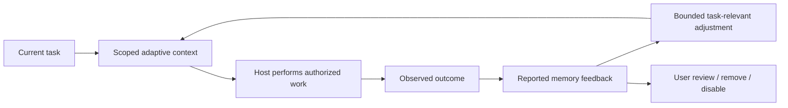

# Learning from work

Shadow Brain 7.1.4 can reuse project-specific feedback when assembling adaptive context. The loop is explicit: select relevant memory, do the task in the host, observe the result, report what helped or failed, and inspect the effect on later retrieval.

The MCP tool assigns `reporter: agent`; portal and CLI feedback assign `reporter: user`. Neither reporter can claim its result is machine-verified by this system. Source and evidence references are not fetched. A tool call succeeding is not evidence that the task succeeded.

## What changes in retrieval

Feedback operates only on direct lexical candidates that passed normal project and curation filters. It cannot create a match, boost a graph-only neighbor, revive archived/contested/superseded memory, add source provenance, or alter stored memory content.

The task matcher drops generic action words and compares substantive terms. A report needs at least one substantive overlap and a Jaccard similarity of at least 0.34 with the current query. Up to three recent matching distinct tasks contribute. The adjustment is the mean of each rating value multiplied by task similarity and reporter weight.

| Input | Value |
| --- | ---: |
| Useful | +0.08 |
| Not useful | -0.04 |
| Incorrect | -0.12 |
| User reporter weight | 1 |
| Agent reporter weight | 0.5 |
| Final adjustment bounds | -0.12 to +0.08 |

The final score cannot go below zero. The candidate report exposes the signed **Project task feedback** signal, contributing record IDs, and reporter kinds. This is a ranking heuristic, not a confidence or truth score.

An identical memory/task/reporter combination updates its prior record. When eligible exact-text duplicates are grouped, the newest report from each normalized task can contribute once, with user reports taking precedence over agent reports. Candidate details retain the contributing report IDs. The sidecar is limited to 500 records and 2 MiB, with bounded task, reason and evidence fields. At capacity, a new distinct record is rejected. Existing records can still be updated or removed. Changes use revision checks and atomic file replacement. No age expiry is silently imposed.

## Keep control

- Turn local learning influence off to retain records while restoring baseline adaptive scoring.
- Remove a report to withdraw its influence.
- Use normal memory curation to mark a claim contested or archive an outdated record. An `incorrect` report does not secretly change curation state.
- Review agent reports against actual checks. A plausible explanation can still be wrong.

This feature is limited to the explicit project workspace and matching local MCP/CLI store. Library callers opt in by passing a `ProjectFeedbackSnapshot` to `assembleContext`. Existing global-store retrieval and legacy profiles do not automatically adopt feedback.

[Project Kit walkthrough](PROJECT_KIT.md) · [Retrieval evaluation](evaluation/CONTEXT_EVALUATION_v7.1.4.md)
