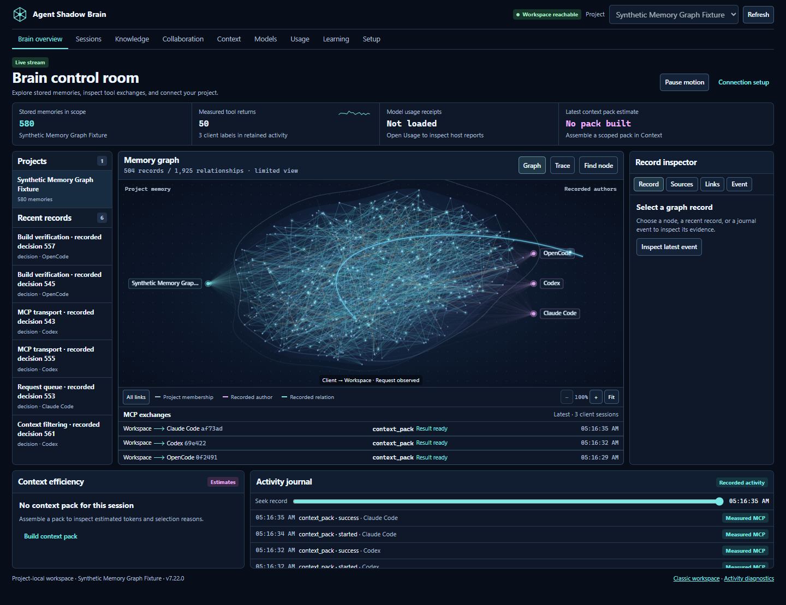
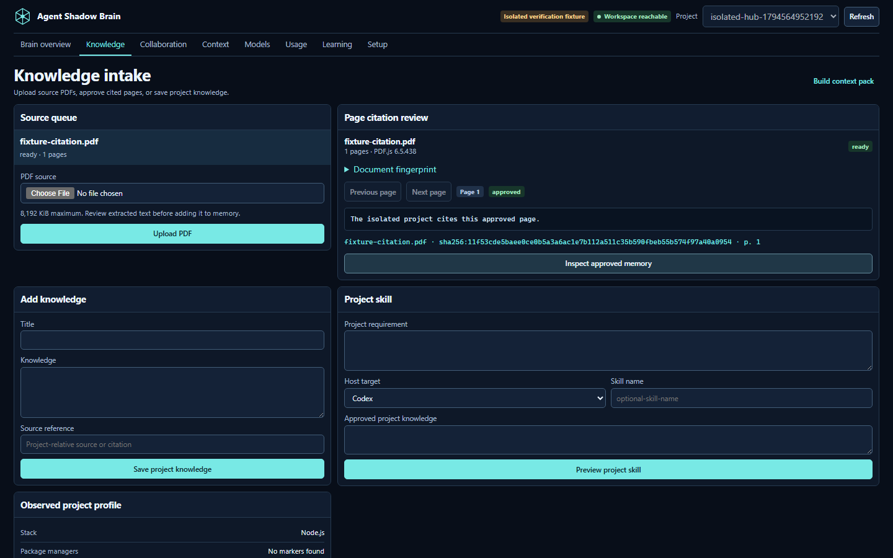

# Quickstart

This guide covers the 7.22.0 Brain Hub. Use Node.js 22.13 or later in the 22.x line, 24.x, or 26 and later.

## Install and open a project

From the project directory, you can start with one command:

```bash
npx --yes --package @theihtisham/agent-shadow-brain@7.22.0 shadow-brain project workspace . --port 62595
```

Or install the reusable CLI:

```bash
npm install -g @theihtisham/agent-shadow-brain@latest
shadow-brain --version
cd your-project
shadow-brain project workspace . --port 62595
```

Check that the CLI prints `7.22.0` for these steps. Keep the command running and open [the Brain Hub](http://127.0.0.1:62595/hub). The process writes project data inside the selected project’s `.shadow-brain` directory. On restart, run the same command from the same project directory. If you use `--port 0`, open the URL printed by the current process.

From a source checkout, use `npm ci` and `npm run build`, then replace `shadow-brain` with `node dist/cli.js` from the checkout. Pass the intended project directory as the workspace argument.



## Save a fact in ordinary words

1. Open **Knowledge** and type “The cupboard is black. Keep its brass handles.”
2. Click **Add to memory**. No title, JSON or upload is required.
3. Open **Context** and ask “What colour is the cupboard?” The returned reference includes your note and a link to its original text.
4. Connect your chosen host through **Setup** so it can retrieve the same memory through MCP.

For longer notes, choose **Review first** and save the useful parts. Optional PDF and JSON imports stay available below the plain-text form. Image-only PDFs need OCR, which is not included.



## Connect a host

```bash
shadow-brain project config . --target codex
shadow-brain skills install . --target codex
```

Merge the recipe into the selected host’s configuration. Preview the skill-file changes, then use `--apply` if you want them. Reconnect the host and confirm it can call a tool such as `project_inspect` or `context_pack`. Host file presence, recorded activity, and model evidence are shown separately. [Supported client recipes](INTEGRATIONS.md)

## Explore shared work

Create a room in **Collaboration**, add a task, and record a proposal or critique. A participant can claim the task, attach a project-relative artifact, and record a result. **Learning** turns recorded outcomes into candidates with explicit evaluation and promotion. [Workspace guide](WORKSPACE.md)

The classic workspace at `/workspace` provides detailed memory review, context selection, and retrieval feedback. `/live` opens the detailed journal. `shadow-brain demo workspace --port 0` runs a separate synthetic tour.

[Visual guide](VISUAL_GUIDE_v7.22.0.md) · [Troubleshooting](TROUBLESHOOTING.md)

## Plain-language notes, sessions, and live files

In **Knowledge**, paste ordinary notes or a plan and choose **Add to memory**. Direct saving accepts 6,000 characters and 20 paragraphs; **Review first** handles longer notes. **Context** lets you try a task, inspect original evidence, and compare a focused context pack with a bounded reference under the same project controls. **Learning** records usefulness feedback.

Open **Sessions** for explicitly reported conversation history and saved handoffs. A connected host can call `session_open`, record meaningful progress, and create a checkpoint; another host calls `session_resume` with that checkpoint to continue. Imported transcripts are deliberate snapshots, not automatic access to native private chat history. [Sessions guide](SESSIONS.md).

In **Setup**, choose sharing preferences, context ceilings and optional **project file activity**. A filesystem event does not identify its author. Pushed updates need the local server to remain running. Tool participation applies to cooperating client labels; it does not configure or control another application globally.
