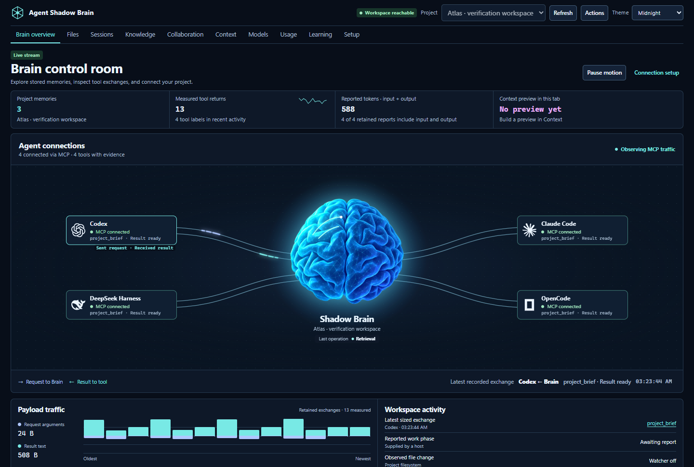
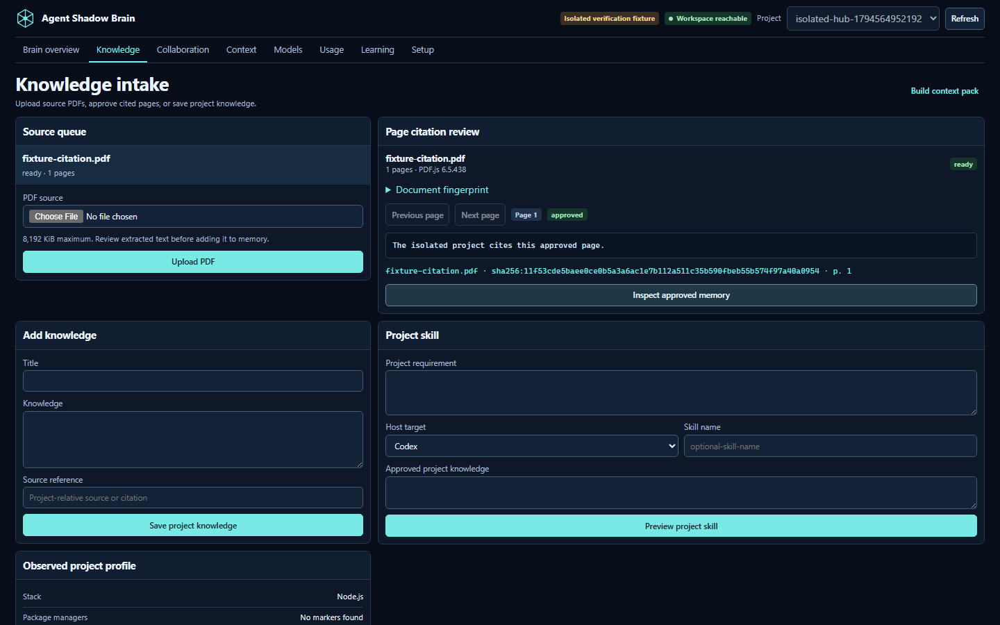

# Quickstart

This guide covers the 7.25.0 Brain Hub. Use Node.js 22.13 or later in the 22.x line, 24.x, or 26 and later.

## Install and open a project

From the project directory, you can start with one command:

```bash
npx --yes --package @theihtisham/agent-shadow-brain@7.25.0 shadow-brain project workspace . --port 62595
```

Or install the reusable CLI:

```bash
npm install -g @theihtisham/agent-shadow-brain@latest
shadow-brain --version
cd your-project
shadow-brain project workspace . --port 62595
```

Check that the CLI prints `7.25.0` for these steps. Keep the command running and open [the Brain Hub](http://127.0.0.1:62595/hub). The process writes project data inside the selected project’s `.shadow-brain` directory. On restart, run the same command from the same project directory. If you use `--port 0`, open the URL printed by the current process.

From a source checkout, use `npm ci` and `npm run build`, then replace `shadow-brain` with `node dist/cli.js` from the checkout. Pass the intended project directory as the workspace argument.



## Save a fact in ordinary words

1. Open **Knowledge** and type “The cupboard is black. Keep its brass handles.”
2. Click **Add to memory**. No title, JSON or upload is required.
3. Open **Context** and ask “What colour is the cupboard?” The returned reference includes your note and a link to its original text.
4. Connect your chosen host through **Setup** so it can retrieve the same memory through MCP.

For longer notes, choose **Review first** and save the useful parts. Optional PDF and JSON imports stay available below the plain-text form. Image-only PDFs need OCR, which is not included.



## Connect a host

Open **Setup → Host connections**. Choose **Connect** on a detected host that supports project setup. For a manual host, expand its guide and copy the entry into the host’s MCP settings. Reload the host, approve the project server if prompted, and ask it to call `project_brief`. The connection count shows a live MCP transport. The exchange appears when the host actually calls a tool.

**Automatic connections** lets the running portal check every minute for supported installations and prepare available project configurations. **Project tool participation** pauses agent access for every participating tool in this project. Each host also has an admission switch. [Host compatibility](INTEGRATIONS.md)

For manual CLI setup:

```bash
shadow-brain project config . --target codex
shadow-brain skills install . --target codex
```

Merge the recipe into the selected host’s configuration. Preview the skill-file changes, then use `--apply` if you want them. Reconnect the host and confirm it can call a tool such as `project_inspect` or `context_pack`. Host file presence, recorded activity, and model evidence are shown separately. [Supported client recipes](INTEGRATIONS.md)

## Capture exact shared conversation history

In **Setup → Features**, you can enable **Exact shared conversation history** for the current project. It starts off. A connected host needs explicit support for reporting original user-visible messages and permission to share the selected conversation. Setup shows the count for enrolled project conversations that report coverage, including a confirmed zero. **Exact message counts unreported** means there is no confirmed count for this project view. In **Sessions**, open the conversation and choose **Read original messages** to load a page under the current sharing controls.

For a compatible MCP host, call `session_open` with `hostSessionId` and `exactTranscript: true` alongside the session key, title and goal. Call `session_append_turn` with the returned `sessionId`, a stable `hostMessageId`, the `user` or `assistant` role, and the original message `text` (up to 64 KiB of UTF-8). Reuse the same message ID and role when retrying. After reconnecting, use `session_resume` or `session_recover` to enroll a new linked session before reporting new messages. An authorized history lookup uses `session_transcript_read` with the session ID and follows `nextBefore` using `before` for earlier pages. `project_brief` still returns selected evidence and saved next steps. [Sessions guide](SESSIONS.md)

## Continue the same task in another agent

1. In **Workspaces**, open the dashboard for the project you want. Its file browser, memories and saved sessions use that project directory.
2. Ask the first connected agent to save a checkpoint in **Sessions**. Include the goal, working approach, constraints, evidence and the next unfinished step. You can also save a checkpoint yourself.
3. In the second agent, ask “Find the handoff for my task and continue from the saved next step.” With the same project MCP server available, it can call `session_handoffs`, choose a matching checkpoint and call `session_resume`. If several tasks match, identify the conversation title you want.
4. When **Shared checkpoints in context** is on, a matching task brief automatically includes a saved next step and fingerprint within its token budget. Change this in the project's feature settings. Hiding a conversation also excludes its inherited handoffs from agent context.
5. A host without MCP can receive a text handoff. Open the saved checkpoint and choose **Copy handoff for any agent**. Paste it into your chosen conversation. An MCP-connected host can record its next checkpoint back in the project.
6. To carry over a decision from a project document, select the Markdown or text file in **Files**, choose the review action and approve the relevant passage in **Knowledge**. The passage retains its original relative path and evidence link.

## Explore shared work

Create a room in **Collaboration**, add a task, and record a proposal or critique. A participant can claim the task, attach a project-relative artifact, and record a result. **Learning** turns recorded outcomes into candidates with explicit evaluation and promotion. [Workspace guide](WORKSPACE.md)

The classic workspace at `/workspace` provides detailed memory review, context selection, and retrieval feedback. `/live` opens the detailed journal. `shadow-brain demo workspace --port 0` runs a separate synthetic tour.

[Visual guide](VISUAL_GUIDE_v7.25.0.md) · [Troubleshooting](TROUBLESHOOTING.md)

## Plain-language notes, sessions, and live files

In **Knowledge**, paste ordinary notes or a plan and choose **Add to memory**. Direct saving accepts 6,000 characters and 20 paragraphs; **Review first** handles longer notes. **Context** lets you try a task, inspect original evidence, and compare a focused context pack with a bounded reference under the same project controls. **Learning** records usefulness feedback.

Open **Sessions** for explicitly reported conversation history and saved handoffs. A connected host can call `session_open`, record meaningful progress, and create a checkpoint; another host calls `session_resume` with that checkpoint to continue. Imported transcripts are deliberate snapshots, not automatic access to native private chat history. [Sessions guide](SESSIONS.md).

In **Setup**, choose sharing preferences, context ceilings and optional **project file activity**. A filesystem event does not identify its author. Pushed updates need the local server to remain running. Tool participation applies to cooperating client labels; it does not configure or control another application globally.
