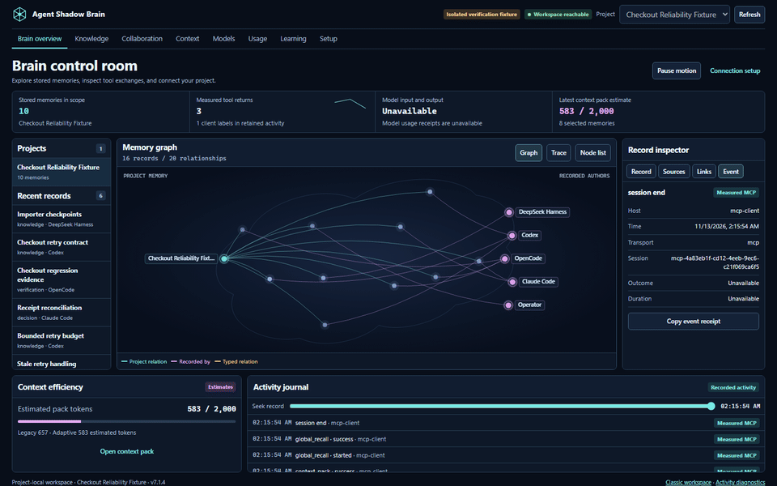
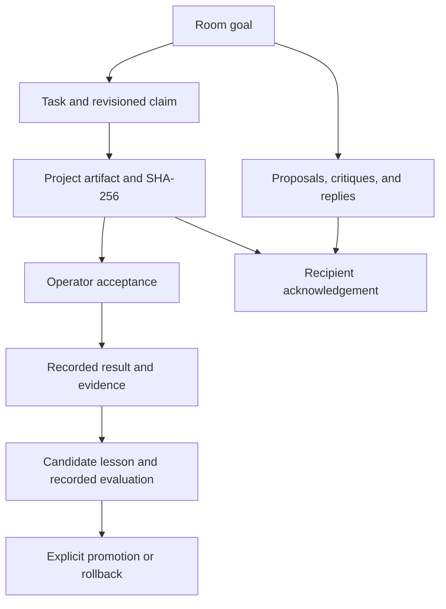

# A visual guide to Agent Shadow Brain

These captures show the running app on an isolated project with synthetic fixture content. The workspace persisted the records and processed local MCP calls. The model field remains unavailable.

## Open the control room

Start `shadow-brain project workspace . --port 62595` and open `/hub`. The header confirms whether the local workspace responded. A reachable workspace can have no host activity. When the process stops, the page retains its loaded snapshot and retries. Restarting the same project on the same port restores the route.

| Visual | Evidence |
| --- | --- |
| Cyan graph links | A memory belongs to a project. |
| Pink graph links | A memory was recorded by an agent or operator. |
| Amber graph links | A persisted typed relationship, or a reported event when its route is highlighted. |
| Moving packet | A newly received journal record. Measured MCP events use cyan; explicit host reports use amber. |
| Fine blue lattice | Illustrative surface. The record and relationship counts come from the graph API. |
| Inspector | Stored record, source references, links, or a selected journal event. |

Choose a node with the pointer or open **Node list** and select it with the keyboard. **Clear focus** restores the surrounding relationships. **Trace** lists retained journal events. Seek with the slider or select a timeline row. **Latest** follows new events. **Pause motion** and the system reduced-motion preference stop animation.

## Approve a cited page

Upload a project PDF and open a page. Review its extracted text and citation before approving it into the project’s memory. Uploading identical bytes returns the existing document. Image-only pages require OCR, which this build does not provide. **Add knowledge** accepts explicit text. The **Project skill** form previews a generated host skill and applies that exact plan after review.

## Share a workstream

The browser and project-local MCP tools can read the same workroom, report outcomes, and resume from recorded state. Lessons record operator-supplied comparisons. Promotion requires a failed baseline, a passing candidate, and passing safety controls. Rollback archives the promoted memory’s retrieval influence. Native host loading and a live exchange should be checked in each selected host.

## Inspect estimates and host evidence

- **Context** builds a pack for the selected project and can compare adaptive and legacy retrieval. The estimates describe rendered context. Review the selected sources before copying.
- **Models** shows local client skill-file checks and retained activity evidence. Model identity and provider counts stay unavailable.
- **Usage** separates measured tool timing from explicit reports. Counts describe the retained journal loaded by this workspace. Context token estimates do not quantify provider charges.
- **Setup** provides configuration recipes and live feature controls. A printed recipe or detected skill file does not establish that a host connected.

[Quickstart](QUICKSTART.md) · [Workspace guide](WORKSPACE.md) · [Troubleshooting](TROUBLESHOOTING.md)
