# A visual guide to Agent Shadow Brain

The aim is to make project knowledge useful across your AI tools, and make that work easy to follow. This guide separates the **proposed Brain Hub** from the **existing development workspace**. Version 7.1.4 is still in development; the new portal images use example data.

[Back to the README](../README.md) · [Run the development workspace](QUICKSTART.md) · [Current component catalog](COMPONENTS.md)

[Download the interactive design](previews/control-room.html) and open it locally. The HTML is self-contained and uses example data.

## Start with the control room

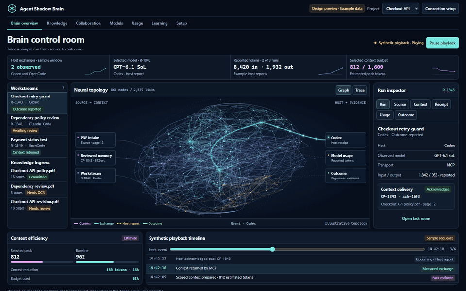

The user-selected direction is a dense network with more motion. The fine network provides depth and structure; readable source and host labels provide orientation. Focus reveals the route you selected. Pausing the preview freezes its sample playback. Reduced motion keeps the same information available without continuous movement.

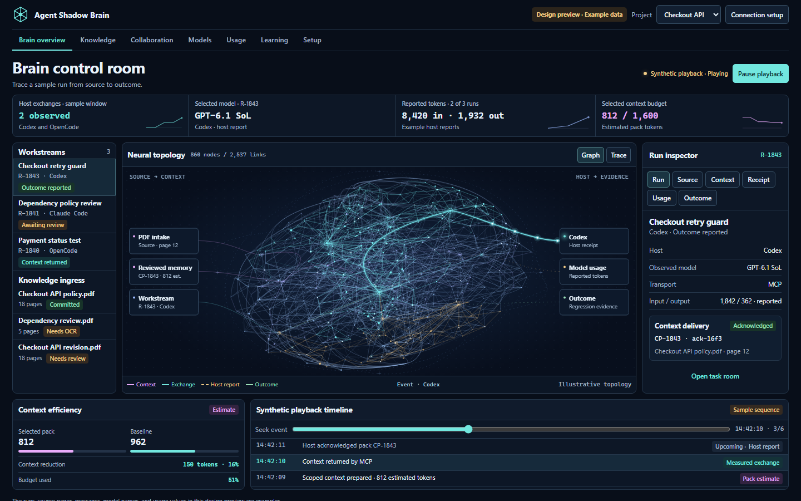

Read the screen from left to right:

1. **Work and sources:** choose the task or knowledge item you want to understand.
2. **Network:** follow the selected source, context and host connection.
3. **Inspector:** inspect the reported model, context references, receipt and outcome for that operation.
4. **Bottom instruments:** compare context sizes and follow the event sequence.

The background neural topology is conceptual. In a production view, route activity must correspond to recorded exchanges. A beautiful pulse does not establish that a model received or used a passage.

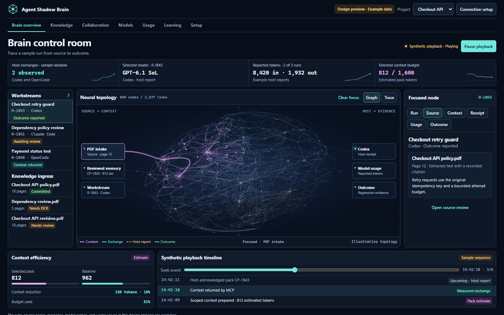

Selecting a source reduces the visual noise and brings its passage into the inspector. Clear focus to return to the full topology.

| Visual | Meaning |
| --- | --- |
| Knowledge route | A source or reviewed passage contributes to the selected context. |
| Directed exchange | A context pack, message or artifact moves between participating components. |
| Reported event | A host or user supplied the observation; its origin remains visible. |
| Offline or unavailable | No current exchange or requested metric is available. |
| Focused path | The chosen operation and its relevant neighbors; unrelated paths recede. |
| Synthetic playback | A scripted design example, with no connected model behind it. |

## Knowledge intake

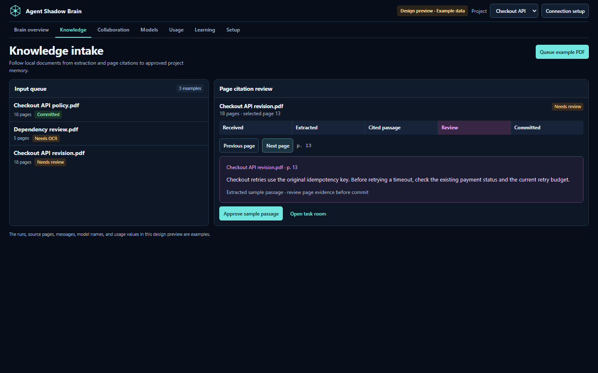

The planned document workflow keeps source versions, page locators and extraction status together. A corrected PDF becomes a new reviewable version. It should not silently change a citation attached to earlier work.

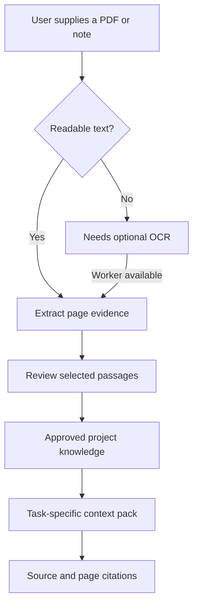

This is planned behavior. The current project knowledge tools accept explicit text. They do not yet implement this PDF extraction interface. A parser, an OCR worker and a model each have separate capabilities; the setup should say which are available.

## Collaboration

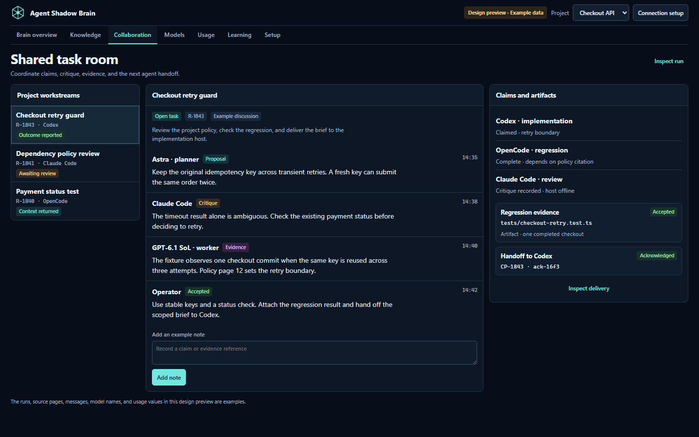

A proposed work room has a shared goal and completion criteria. Agents can post ideas, challenge an assumption, claim a task, attach a result and acknowledge a handoff. The room records who said what and which evidence they referenced.

Two agents claiming the same task must not both become its owner. A disconnected agent must be able to resume from a durable cursor. Those are backend acceptance requirements, not behaviors established by this design image.

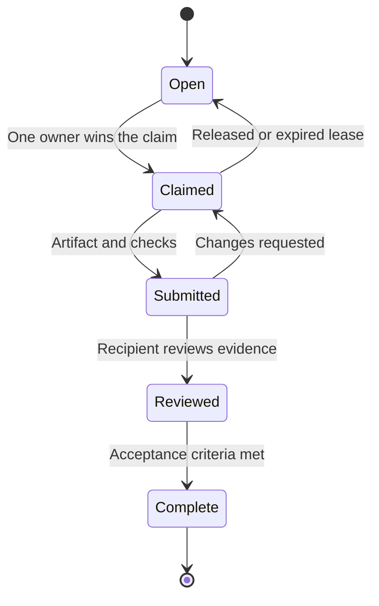

The native host controls its own tools and execution. A managed task started through the hub is a different execution path. Connecting an MCP server alone does not grant the hub control of every host.

## Models and usage

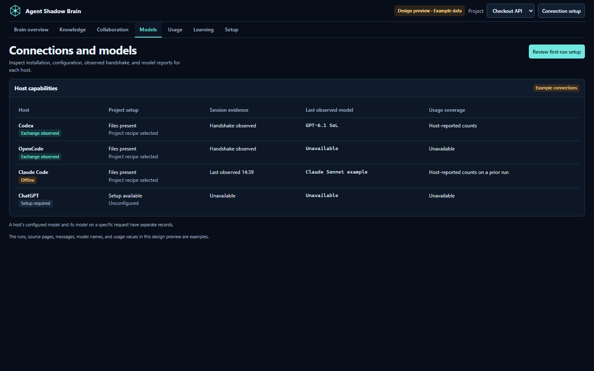

The model selected in a settings menu is not necessarily the model used by another host. The proposed inspector shows the model reported for the selected call, plus the connector and evidence that supplied it.

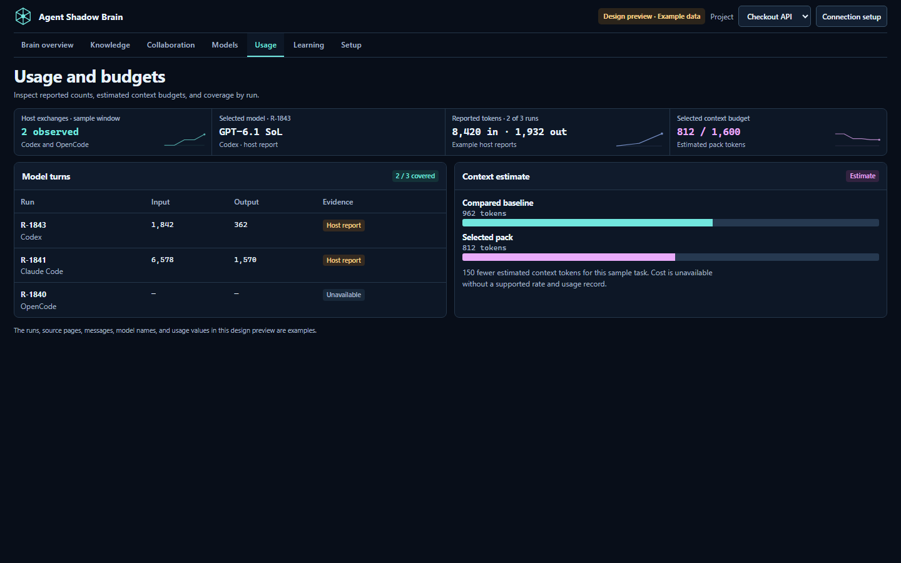

| Number | How to read it |
| --- | --- |
| Input and output tokens | Counts reported by a supported provider or host, tied to a request or attempt. |
| Cached tokens | A provider-specific category; it may already be included in input totals. |
| Pack estimate | Estimated context size, with the estimator identified. |
| Context reduction | A comparison against a named baseline using the same counting method. |
| Coverage | How many calls supplied the relevant metric. |
| Unavailable | Missing information, not a measured zero. |

The existing context path estimates pack size. The broader automatic model ledger and paired savings measurements are planned work. A shorter context pack alone does not prove a lower bill or a better answer.

## Learning and skills

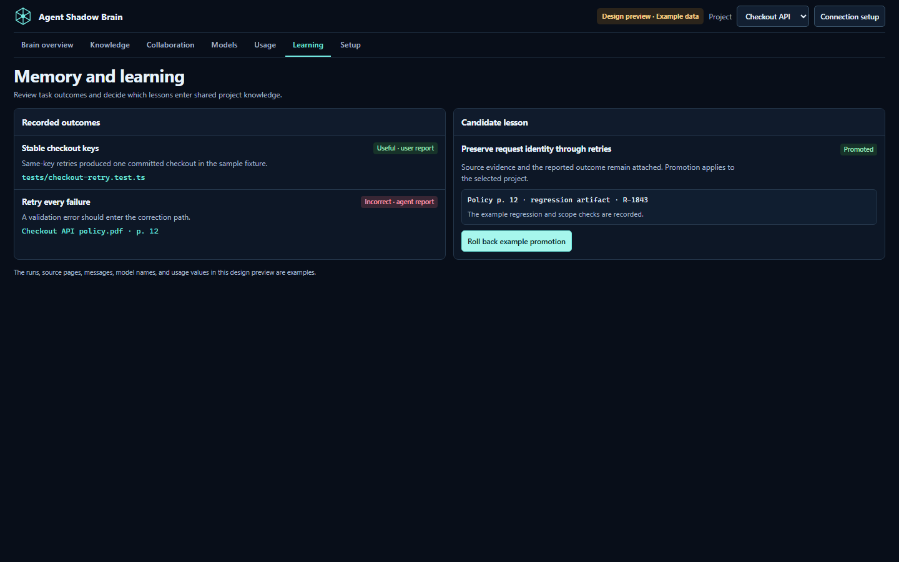

The existing project feedback mechanism can make a small, task-specific adjustment to adaptive retrieval. The planned learning cycle adds evidence, held-out evaluation, versioned promotion and rollback.

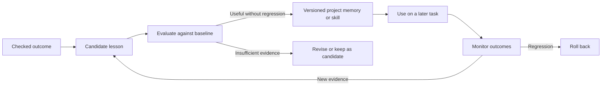

A generated skill stays local to the selected project unless explicitly promoted. Imported instructions are reviewed as content before they become behavior. Existing ownership checks protect files the user has edited. This learning approach changes memory, skills or retrieval policy; it does not imply model-weight training.

## Setup

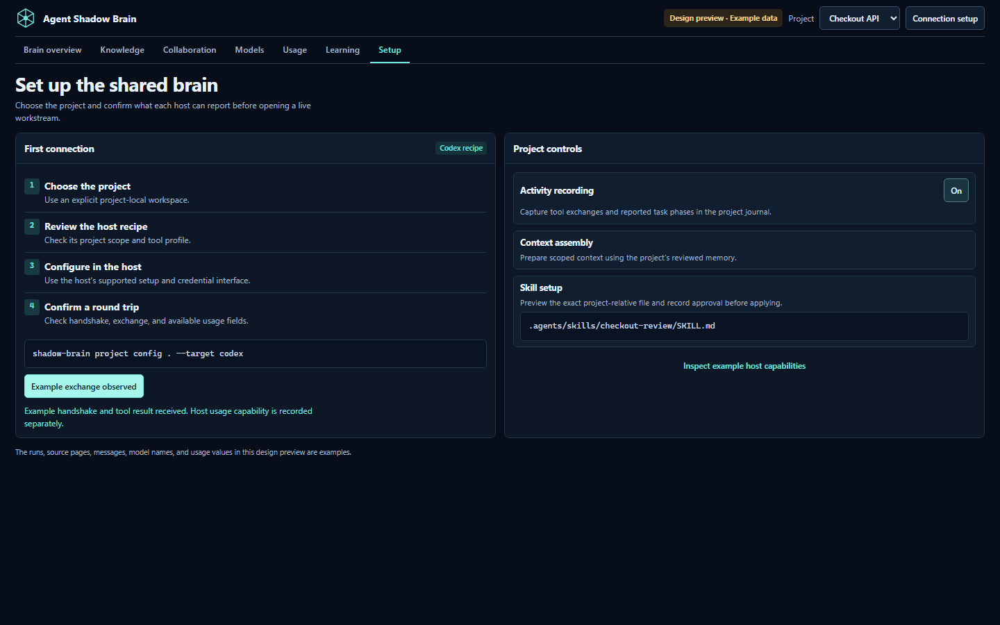

The intended setup flow is: select the workspace, choose the host, prepare its scoped configuration, perform an observable exchange, then show the capabilities actually verified. Model usage and cancellation are separate capabilities. A host can support knowledge tools without exposing them.

Current setup recipes and project skills are described in [Integrations](INTEGRATIONS.md). The image above is the proposed guided experience; its example connection does not configure a real host.

## The working foundation

These are captures of the existing development workspace with synthetic fixtures. They are separate from the new design preview.

Use Project Kit to add explicit knowledge and preview a task-specific project skill. [Step-by-step guide](PROJECT_KIT.md).

Context Lab lets you inspect what was selected and why, with a budget and recorded source references. [Context Lab guide](CONTEXT_LAB.md).

The saved graph distinguishes recorded support, related notes, contradictions and supersession. Those relationships remain useful foundations for the new portal. [Workspace reference](WORKSPACE.md).

## What is implemented and what remains

| Area | Existing development code | Planned extension |
| --- | --- | --- |
| Knowledge | Explicit project text and reviewed memory | PDF page extraction, source versions and intake queue |
| Context | Scoped assembly, ranking explanations and budget estimates | Delivery and attachment receipts across supported hosts |
| Work | Handoff and transport primitives | Durable shared rooms, claims, artifacts and acknowledgements |
| Learning | Bounded reported-outcome feedback | Checked candidate lessons, evaluation and versioned rollback |
| Usage | Context estimates and separate provider/ledger paths | Normalized automatic usage with per-call coverage |
| Interface | Memory workspace, Live and advanced views | One dense control room wired to the shared hub |

The release must demonstrate the connected workflow with real clients, not only these examples: a source reaches a task, agents exchange work, the result is checked, and a lesson improves a later attempt.
