# Brain Hub 7.22.0 visual guide

These captures are from the running local Hub with an isolated synthetic fixture. The dense fixture contains 580 stored memories and explicit recorded links. Scripted MCP clients produce the observed tool activity. The graph can display up to 500 memories, with project and author nodes in addition to that sample. The animation shows actual measured `context_pack` tool calls against the fixture.

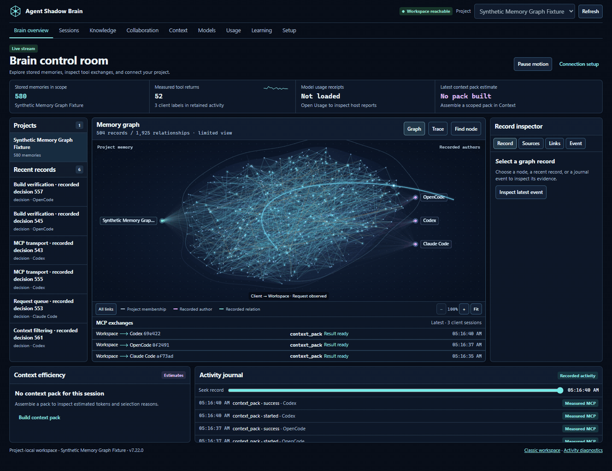

## Inspect tools and reported workers

The tool activity panel shows recognizable local icons and a separate count of reporting MCP connections. Hover or focus a tool to inspect it; select it to keep its details open. Individual session chips retain different workers and models. A shared conversation receipt is not assigned to one worker by guessing. **Escape** closes the details and returns focus to its tool.

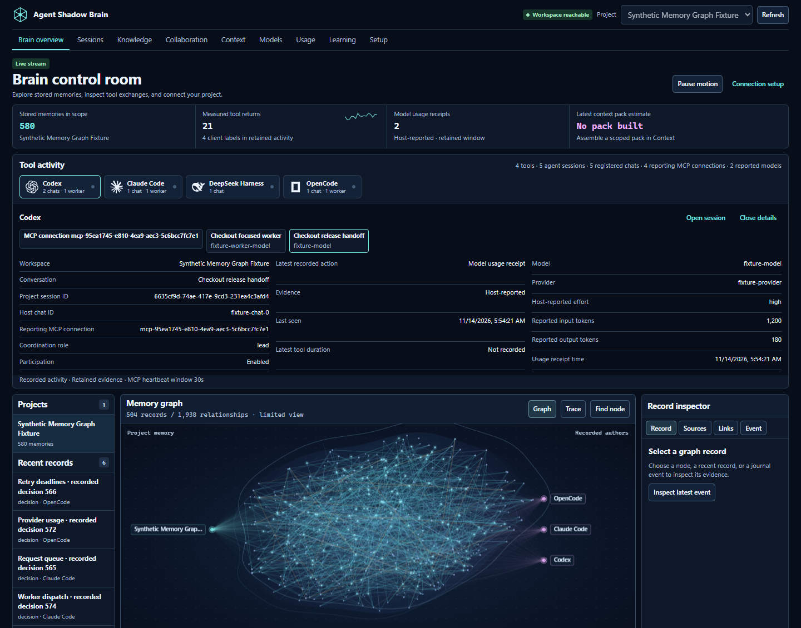

This additional capture uses four initialized scripted MCP clients, five registered sessions and two synthetic model receipts in an isolated project. The icon identifies the client tool; the provider, model and effort fields retain their host-reported labels. It does not show native application or model execution.

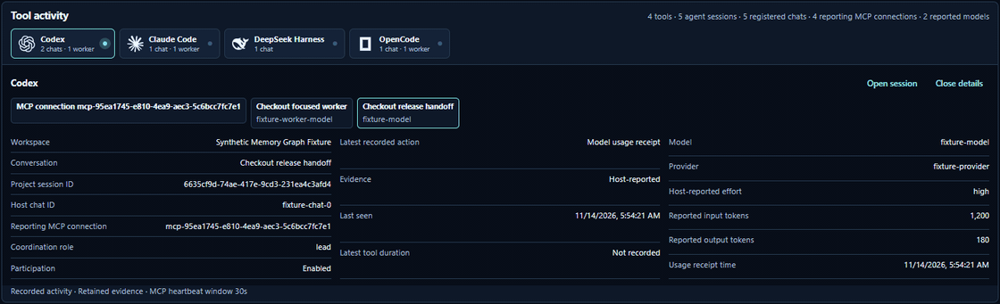

Heartbeats renew every ten seconds and expire after thirty seconds. They update only the presence readout and never animate tool work. Missing metadata stays unavailable. Motion stops when paused, hidden or reduced-motion is requested.

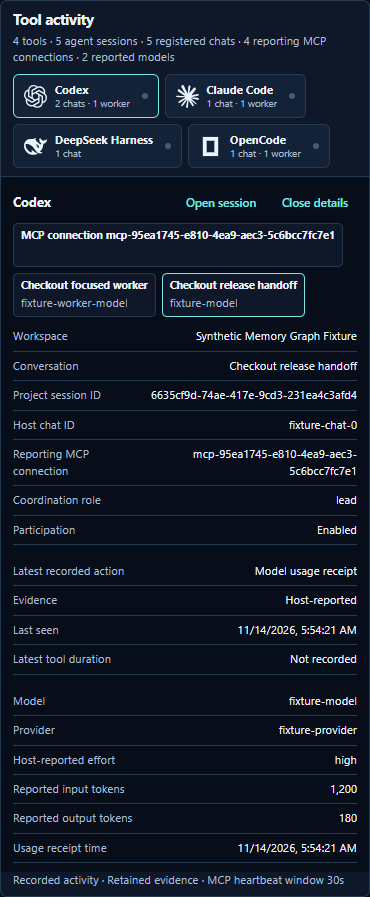

## Explore the memory graph

**Find node** lists visible records and searches stored memories in the selected scope. Pick a result to inspect its content, sources, and relations. **+**, **−**, and **Fit** control the graph view. Drag to pan after zooming. Use the relationship buttons to filter the visible edges by project membership, author, or recorded memory relation.

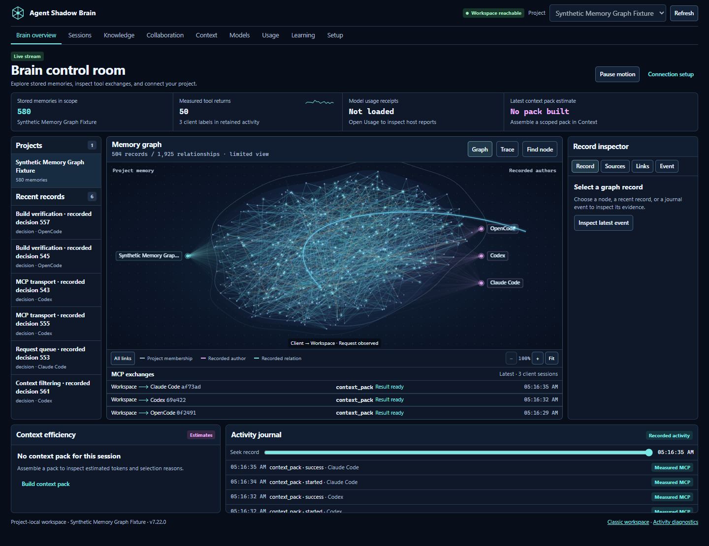

## Follow a measured exchange

**MCP exchanges** shows recent measured tool activity by client session. The incoming arrow marks a request the workspace observed. The outgoing arrow marks a result ready at the tool boundary. Select an exchange to inspect its timing, status, and matching request or result when both are in the loaded history. **Latest** returns to incoming activity. **Pause motion** keeps the view still.

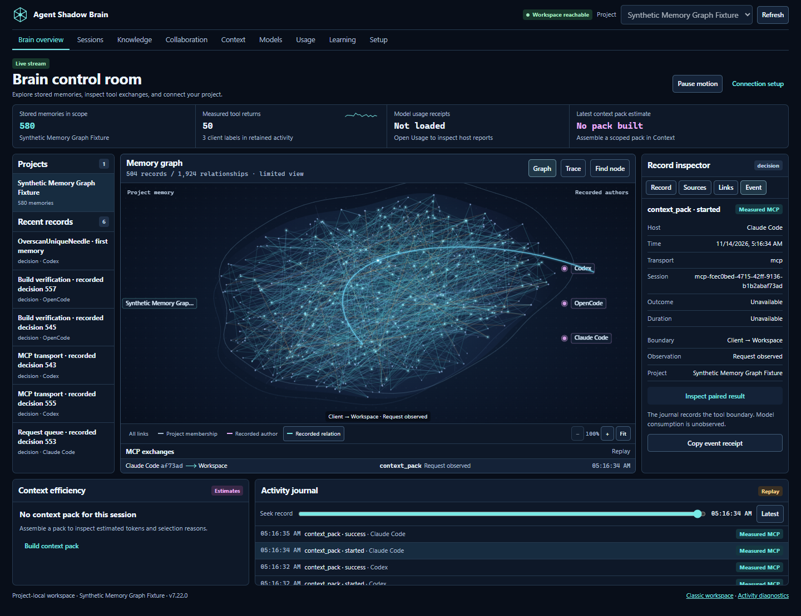

An empty memory store can still have real MCP activity. The graph count stays at zero and the exchange lanes show the measured calls.

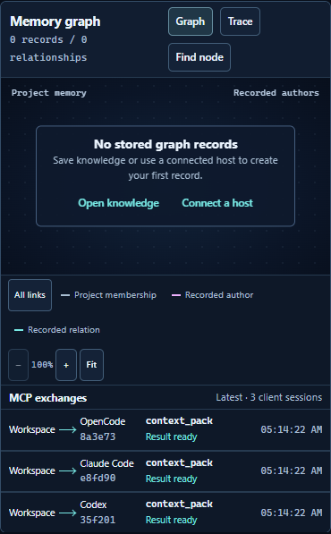

## Teach the project from ordinary notes

In **Knowledge**, write “The cupboard is black” and select **Add to memory**. This directly saves a short note with its original source. For longer notes or changes before saving, choose **Review first**. Review each part, edit the wording if necessary, and select **Save to this project** or **Skip this part**.

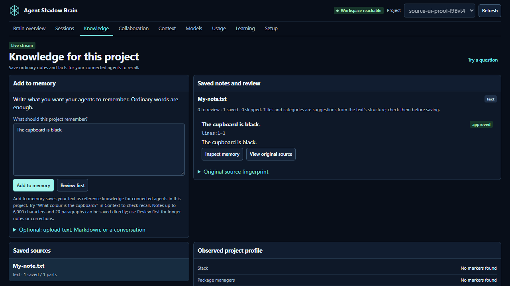

Open **Context**, describe your next task, and select **Find useful context**. The result shows the saved wording, why it matched, and an **Original source** button. The source view shows the original text and your approved correction together. Select **Review usefulness** to report whether a memory helped; rebuilding the same context can show a bounded feedback adjustment. These changes affect stored memory and retrieval, not model weights. The text and clicks above were verified with an isolated synthetic project; no external model response is implied.

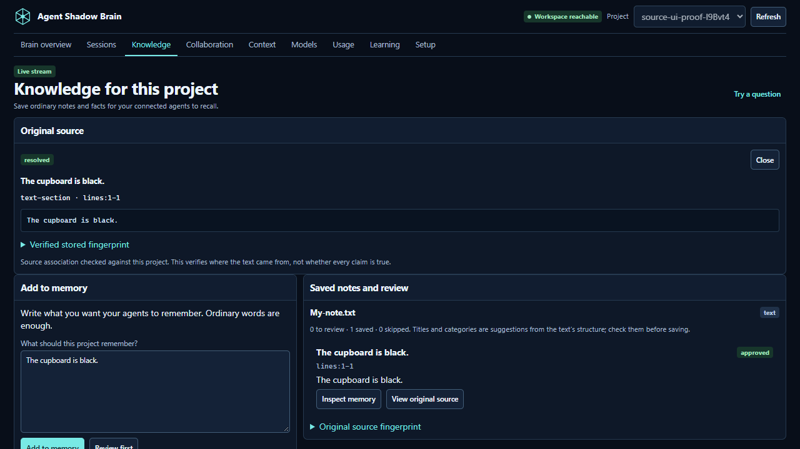

Optional upload sections accept UTF-8 text, Markdown, or the supported JSON examples. The separate PDF workflow reviews extracted pages and cannot perform OCR. See [source intake](SOURCE_INTAKE.md) for formats, limits, privacy, and provenance details.

## Keep and hand off a project session

**Sessions** lists project records and their reported status. Recent activity indicates a recent report, not proof that a native client is still running. A portal session is a manual record and does not start an AI model. Write a note, add your own handoff summary and next steps, then save the checkpoint. **Copy agent resume request** prepares the request for a connected host; **Continue in portal** creates a separate portal-owned session with the saved handoff. The original remains available.

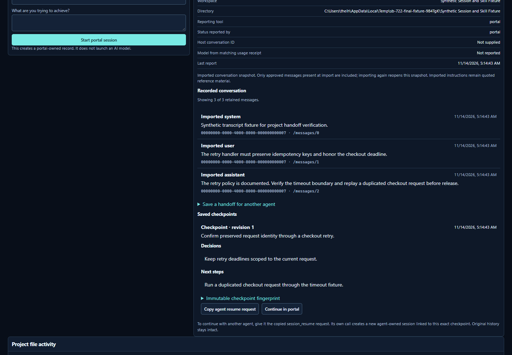

The screenshot is from an isolated synthetic project. The imported transcript was explicitly selected and reviewed: the visible system label describes quoted source material, not an instruction with elevated authority. Only approved messages present at the first import are included; later imports reopen that snapshot. The portal flow and checkpoint continuation were checked in the browser; independent MCP host handoff was tested separately.

## Set what the project shares

In **Setup → Project sharing**, set maximum estimated context tokens and entries. Choose a conversation to control sharing or assign its coordination role. **Tool participation** controls whether a client label can use this project’s Shadow Brain operations.

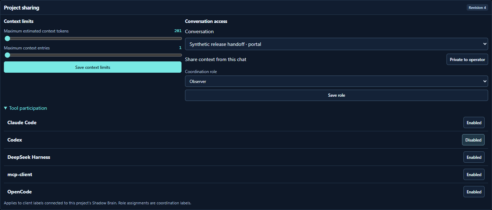

**Context** previews the current delivery rules. **Sessions** retains local audit access and identifies conversations whose contents are withheld from connected agents.

## Manage a generated project skill

Apply a project skill in **Knowledge** to create its local ownership receipt. In **Setup → Managed project skills**, review the exact paths before disabling, enabling, or removing the skill.

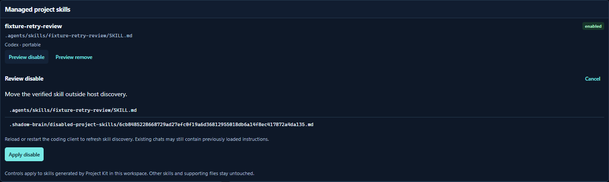

The isolated browser fixture exercised creation, disable, enable, and removal. A separate skill that lacked a Project Kit ownership receipt retained its original bytes.

[Workspace guide](WORKSPACE.md)
