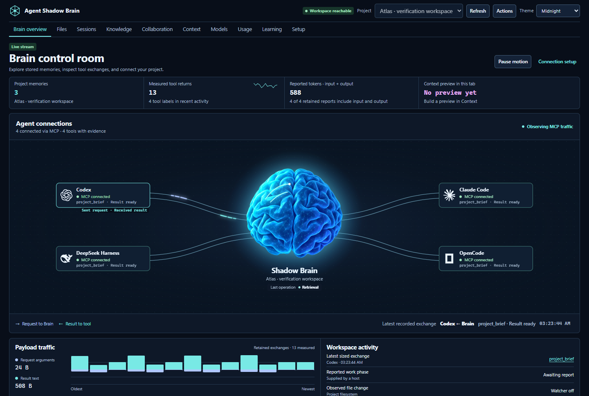
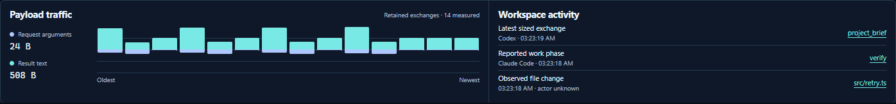
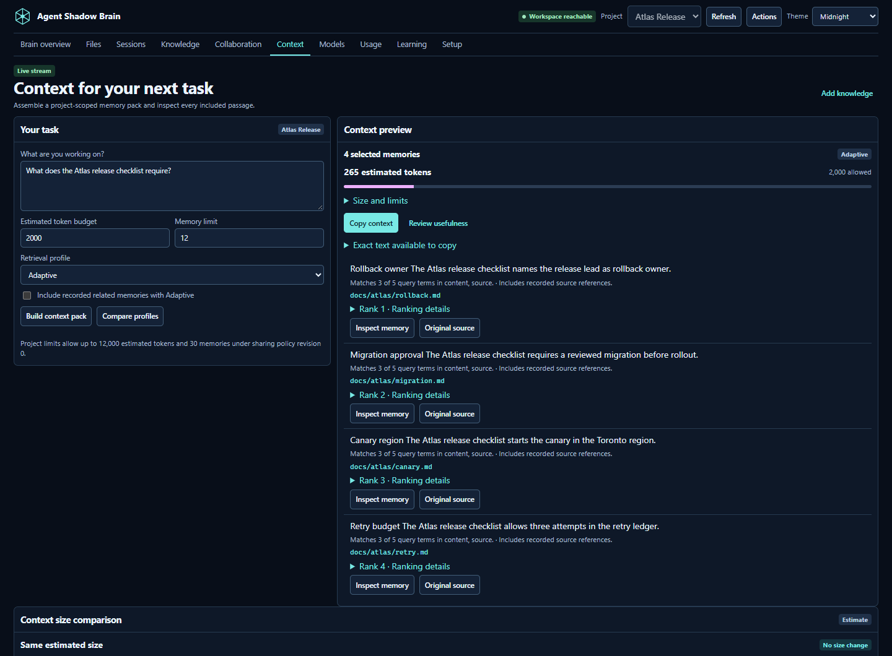

# Brain Hub visual guide · 7.25.0

Start the project portal from the directory you want to share with your tools. Open the `/hub` URL printed by the launcher. The captures use isolated fixture workspaces. Context, Usage and Collaboration show the Atlas Release fixture. [Quickstart](QUICKSTART.md)

## Follow requests and results



In **Brain overview**, a pulse toward the brain represents a recorded request. A pulse back to the tool represents its result. Select a tool to inspect its reported conversation, latest action and available model details. The [traffic recording](assets/7.25.0-agent-traffic.gif) uses four scripted clients connected by MCP stdio. [MCP architecture](https://modelcontextprotocol.io/docs/learn/architecture) · [Sessions and transport evidence](SESSIONS.md)

## Read the traffic beneath the map



Each column is one completed call with measured request-argument and returned-text sizes. Select it to inspect the matching receipt. The project feed shows the latest host-reported phase and the watcher’s most recent file change. Select the file to look up relevant project memory.

## Set up project participation


Open **Setup** to see host installation evidence, workspace configuration, tool admission and MCP presence. Host discovery checks known commands on the process PATH and known extensions in VS Code’s default local installation directory. Configure an available host or use its manual setup guide, reload it, and check **MCP presence**. Automatic connections are opt-in. The capture used fixture launchers and extension folders, plus a scripted client reporting an OpenCode connection. Its current connection remains visible with project tool admission switched off. [Integration recipes](INTEGRATIONS.md) · [VS Code extension locations](https://code.visualstudio.com/docs/configure/extensions/extension-marketplace)

## Retrieve context with sources



Save a note in **Knowledge**, then ask a question in **Context**. Inspect the selected passages and source references before copying the pack. A connected client can ask the project for a compact Markdown briefing with `project_brief`. From [Files](assets/7.25.0-files.png), select a file and use **Look up in Context** to start with its relative path. [Context guide](CONTEXT_LAB.md) · [Source intake](SOURCE_INTAKE.md)

## Check reported usage


Filter **Usage** by host, model, outcome and time. The example has four input counts and three output counts, so only three reports contribute to the paired total. The Context token estimate describes the assembled text. Usage totals derive from the counts a host supplied. [Features and limits](FEATURES_AND_LIMITS.md)

## Record a handoff


Use **Collaboration** to record a proposal, decision and task outcome. The room retains the evidence next to the check it supports. Use **Sessions** when the receiving agent needs a saved checkpoint with the current work, decisions and next steps. [Workflow integration](WORKFLOW_INTEGRATION.md) · [Session handoffs](SESSIONS.md)

## Four facts, two setups


Four scripted callers asked the same question about a release checklist. In the isolated setup, each caller could retrieve the one fact saved in its own store. In the shared setup, any caller could retrieve all four. A citation counted only when the briefing contained the expected fact text, the source label and the memory ID. A receipt counted only when the activity journal held a measured tool start and a correlated successful result. These counts describe the fixture’s access to four known facts. The fixture made no model calls and measured no answer accuracy, latency improvement or cost savings.

Reproduce the counts from the checkout after building. The script creates five isolated temporary stores and exercises the MCP handler with scripted requests. Plotting uses Matplotlib. [Measurement script](../tools/measure-shared-brief.mjs) · [Measured receipts](evaluation/SHARED_BRIEF_v7.25.0.json) · [Chart script](../tools/plot-shared-brief.py)

```bash
npm run build
node tools/measure-shared-brief.mjs > shared-brief.json
python tools/plot-shared-brief.py shared-brief.json shared-brief.png
```
