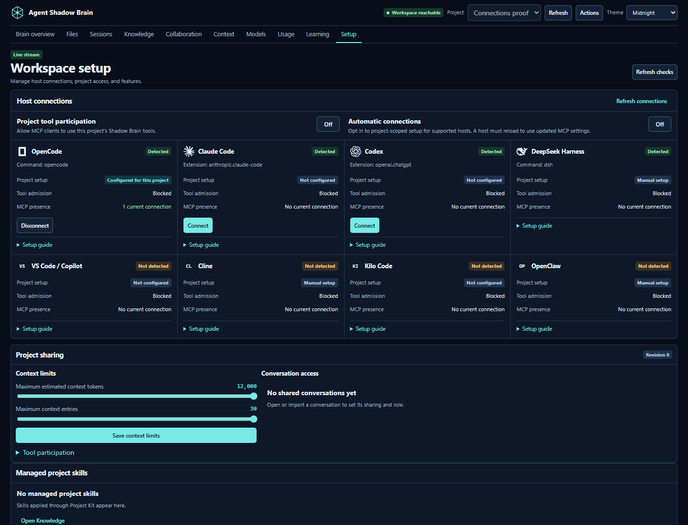
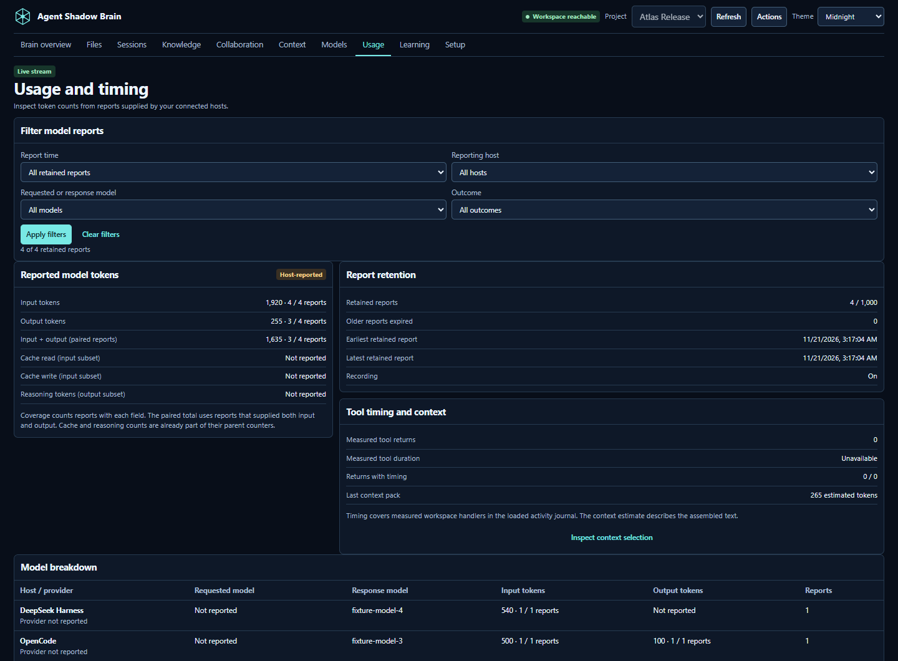
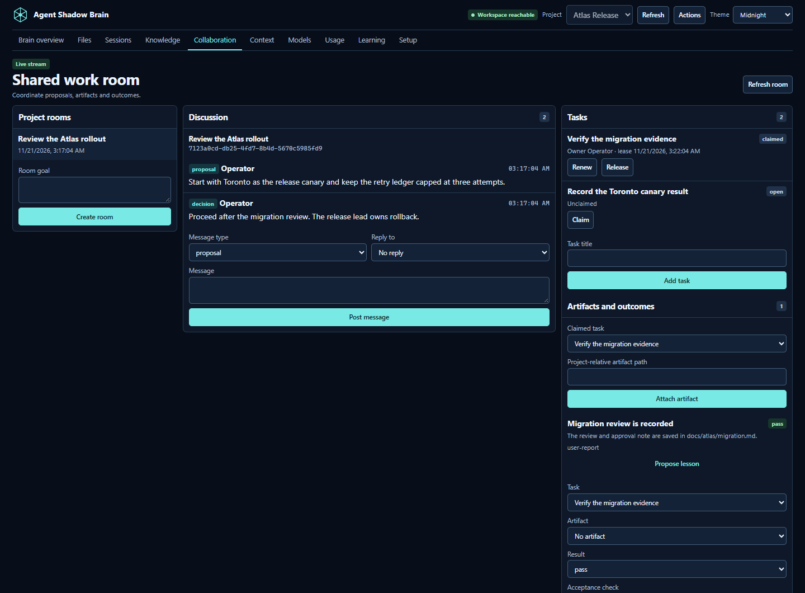
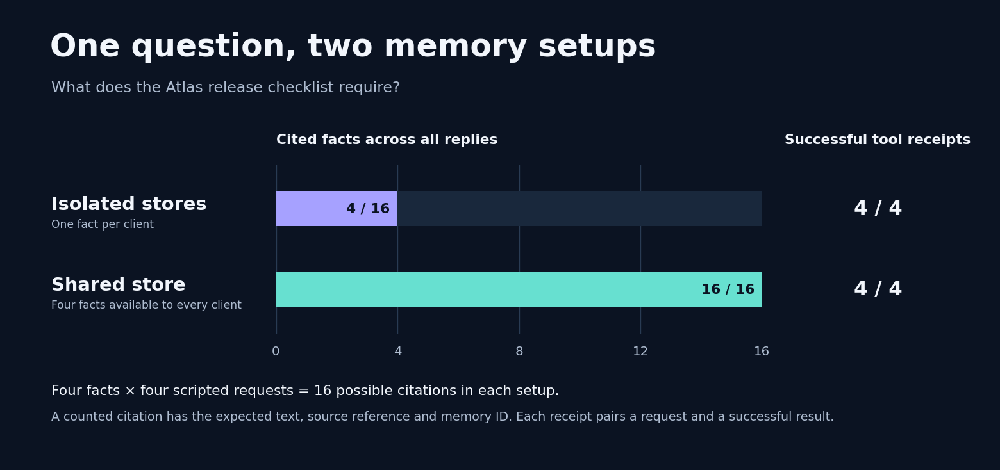

# Brain Hub visual guide · 7.25.0

Start the project portal from the directory you want to share with your tools. Open the `/hub` URL printed by the launcher. The captures use isolated fixture workspaces. Context, Usage and Collaboration show the Atlas Release fixture. [Quickstart](QUICKSTART.md)

## Follow requests and results


In **Brain overview**, a measured request travels toward the brain and its result travels back along the same strand. Select a tool to inspect its reported conversation, latest action, and available model details. Each cortex point represents a saved memory in the current graph. Hover or focus it to read its excerpt, source, date, and latest measured return when known. Select it to open the record or use **Find memories** to search beyond the visible points. **Project knowledge** shows retained saves by date and counts for recorded lesson stages. The fixture uses four scripted MCP clients. [Traffic recording](assets/7.25.0-agent-traffic.gif) · [Sessions and transport evidence](SESSIONS.md)

### Follow one memory through the dots

1. Save “The cupboard is black. Keep its brass handles.” in **Knowledge**. Return to **Brain overview** and look for the saved memory in the brain’s displayed sample.
2. Focus the dot to see its saved excerpt and available source label. Select it to open the memory inspector.
3. Have a connected tool ask `project_brief` for the cupboard finish. Watch the request move toward the brain and the result travel back. The receipt records the selected memory IDs.
4. Focus the returned dot again. **Last returned to** identifies the tool and time if that receipt remains in the loaded activity history. Open **Payload traffic** to inspect the result’s measured text size.

## Read the traffic beneath the map


Each column is one completed call with measured request-argument and returned-text sizes. Select it to inspect the matching receipt. The project feed shows the latest host-reported phase and the watcher’s most recent file change. Select the file to look up relevant project memory.

## Compare registered workspaces


Open **All workspaces** in the overview strip and select a project for its shared chats. The directory shows current MCP presence and each project's latest visible report. Task percentages use completed recorded tasks divided by all recorded tasks. Projects without recorded tasks show **Unreported** under **Task progress**. The capture uses three isolated projects, scripted MCP clients, and stored fixture task records.

Use **Check Codex chat index** to request local titles, timestamps, and index status for the selected project. An indexed conversation and an open MCP transport are separate observations. **Stop listing project** hides it until you explicitly add it again. [Workspace guide](WORKSPACE.md) · [Session handoffs](SESSIONS.md)

## Set up project participation



Open **Setup** to see host installation evidence, workspace configuration, tool admission and MCP presence. Host discovery checks known commands on the process PATH and known extensions in VS Code’s default local installation directory. Configure an available host or use its manual setup guide, reload it, and check **MCP presence**. Automatic connections are opt-in. The capture used fixture launchers and extension folders, plus a scripted client reporting an OpenCode connection. Its current connection remains visible with project tool admission switched off. [Integration recipes](INTEGRATIONS.md) · [VS Code extension locations](https://code.visualstudio.com/docs/configure/extensions/extension-marketplace)

## Retrieve context with sources


Save a note in **Knowledge**, then ask a question in **Context**. Inspect the selected passages and source references before copying the pack. A connected client can ask the project for a compact Markdown briefing with `project_brief`. From [Files](assets/7.25.0-files.png), select a file and use **Look up in Context** to start with its relative path. [Context guide](CONTEXT_LAB.md) · [Source intake](SOURCE_INTAKE.md)

Open **Size and limits** for the exact UTF-8 byte count and the estimated token count. **Exact text available to copy** shows the Markdown tied to those figures. Compare profiles using the same task and inspect which passages each selected.

## Check reported usage



Filter **Usage** by host, model, outcome and time. The example has four input counts and three output counts, so only three reports contribute to the paired total. The Context token estimate describes the assembled text. Usage totals derive from the counts a host supplied. [Features and limits](FEATURES_AND_LIMITS.md)

## Record a handoff



Use **Collaboration** to record a proposal, decision and task outcome. The room retains the evidence next to the check it supports. Use **Sessions** when the receiving agent needs a saved checkpoint with the current work, decisions and next steps. [Workflow integration](WORKFLOW_INTEGRATION.md) · [Session handoffs](SESSIONS.md)

## Four facts, two setups



Four scripted callers asked the same question about a release checklist. In the isolated setup, each caller could retrieve the one fact saved in its own store. In the shared setup, any caller could retrieve all four. A citation counted only when the briefing contained the expected fact text, the source label and the memory ID. A receipt counted only when the activity journal held a measured tool start and a correlated successful result. These counts describe the fixture’s access to four known facts. The fixture made no model calls and measured no answer accuracy, latency improvement or cost savings.

Reproduce the counts from the checkout after building. The script creates five isolated temporary stores and exercises the MCP handler with scripted requests. Plotting uses Matplotlib. [Measurement script](../tools/measure-shared-brief.mjs) · [Measured receipts](evaluation/SHARED_BRIEF_v7.25.0.json) · [Chart script](../tools/plot-shared-brief.py)

```bash
npm run build
node tools/measure-shared-brief.mjs > shared-brief.json
python tools/plot-shared-brief.py shared-brief.json shared-brief.png
```
