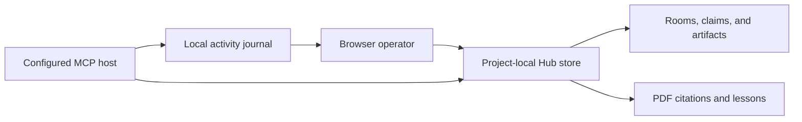

# Focused workflows and project skills

Agent Shadow Brain 7.1.0 bundles practical guidance for coding agents. It helps the host select an appropriate workflow, avoid unnecessary extra work, and check the requested result. It does not call a model or run the task on its own. Your host agent supplies the reasoning, tools, permissions, and execution.

## Share project work through the Hub

From the project directory, launch `shadow-brain project workspace . --port 62595` and open `/hub`. Generate the client’s project-local recipe with `shadow-brain project config . --target codex` or the appropriate target. This routes the browser and host to the same project store.

Compatible project-local MCP clients can read and create rooms, exchange recorded evidence, and propose lessons. Use `hub_artifact_read` with the room ID, artifact ID and recorded SHA-256 from `hub_room_read` to retrieve up to 32 KiB of immutable UTF-8 text. Larger or binary artifacts are available through the project workspace. Room actions record the author and accept an operation key for safe retries. Host claims and artifact proposals carry revisions. The operator reviews evidence and controls lesson promotion and rollback.

Project-local recall refreshes committed memory before each call and excludes archived, contested, and superseded records. The timeline and memory inspection retain those records for review. Approved PDF passages can be selected by project memory and context tools.



[Workspace guide](WORKSPACE.md) · [Client recipes](INTEGRATIONS.md)

## Choose a client and install

Use Node 22.13+ within 22.x, Node 24.x, or Node 26+. Install the package, move to the project root, and preview the files:

```bash
npm install -g @theihtisham/agent-shadow-brain
shadow-brain skills install . --target codex
shadow-brain skills install . --target codex --apply
```

| Target | Skill directory | Project instructions |
| --- | --- | --- |
| `codex` | `.agents/skills/<name>/SKILL.md` | `AGENTS.md` |
| `claude-code` | `.claude/skills/<name>/SKILL.md` | `CLAUDE.md` |
| `opencode` | `.opencode/skills/<name>/SKILL.md` | `AGENTS.md` |
| `deepseek-harness` | `.dsh/skills/<name>/SKILL.md` | `AGENTS.md` |
| `portable` (default) | `.agents/skills/<name>/SKILL.md` | `AGENTS.md` |

Use a comma-separated target list or `--target all` for the four native layouts. Existing identical destinations are deduplicated. Prefer only the targets you use: some hosts can discover several compatible roots. Select a smaller catalog with `--skills shadow-workflow,shadow-debug`. `skills targets` prints the supported mappings; `skills show shadow-debug` prints the complete bundled skill.

The managed project-instruction section points relevant tasks to the installed skills and defers to user and project constraints. Skill discovery remains a host feature: restart or reload the client if its documentation requires it. For DeepSeek Harness, install at its actual project root (nearest `.git` ancestor, or working directory if there is no repository). Enable the host's filesystem skill provider, registry and skill tool, plus agent-instruction context if you want the `AGENTS.md` pointer. This installer does not change host plugin configuration.

Other clients can use the portable layout if they support it, or read an installed `SKILL.md` explicitly. An MCP-capable client can retrieve the same guidance through the tools below. There is no claim that every client automatically discovers these files.

## What each skill contributes

| Skill | Purpose |
| --- | --- |
| `shadow-workflow` | Understand the outcome and constraints, choose the relevant guidance, and scale planning and verification. |
| `shadow-implement` | Inspect relevant code, make the requested change, and verify affected behavior. |
| `shadow-debug` | Isolate a failure using evidence; fix it when requested; confirm the original failure is resolved. |
| `shadow-review` | Report actionable findings with evidence; edit only when the requested scope includes fixes. |
| `shadow-research` | Check relevant sources, separate facts from inference, and answer the user's question. |
| `shadow-release` | Prepare and verify an artifact, perform an authorized release, and independently check the destination. |

Skills keep trivial questions direct, respect planning/diagnosis/review-only requests, and avoid unrelated rewrites, audits, documents, and tests. They ask for missing input only when it materially blocks correct work. Prior authorization counts; a routine second approval is not required. Available memory can supply fallible context, but memory writes are not compulsory. A useful plan states actions and verification, not private reasoning transcripts.

## Preview, updates, and conflicts

Without `--apply`, installation performs no writes. The plan shows destination paths, content, actions, hashes, and warnings (`--json` gives the full structure). Application recomputes and validates the plan and checks existing content before changing files.

Skills are allowlisted bundled files. Differing unowned files, locally edited managed files or blocks, malformed instruction markers, unsafe paths, and stale previews are rejected. Bytes outside the managed instruction block are preserved. A project-local `.shadow-brain/workflow-skills.json` receipt records ownership hashes so later package upgrades can distinguish managed content from local edits. Commit it with the installed skills if your team shares the installation.

Managed updates save original files under `.shadow-brain/workflow-backups/`. Caught write errors trigger best-effort rollback where the files still match this attempt; the installer reports failures instead of silently overwriting concurrent edits. It uses an exclusive project installation lock. Process termination can leave a partial installation and lock; arbitrary concurrent editors are not transactional. Rerun preview after resolving a reported conflict. Do not delete an active lock. After an interrupted process, confirm no installer is running before manually removing an abandoned `.shadow-brain/workflow-skills.lock`.

There is no force-overwrite or uninstall command. To remove the integration, review the receipt and installed paths, remove only the selected managed skill files and delimited instruction blocks, and preserve your own additions. Keep backups until the update has been checked. Do not remove a whole shared skills directory.

The installer never changes global client settings, selects providers/models, reads authentication stores, starts hosts, or executes skill commands. Installing or upgrading the npm package itself does not install skills into projects.

## Advisory request analysis

```bash
shadow-brain workflow analyze "Fix the failing CSV export" --json
shadow-brain workflow analyze "Plan a storage migration; do not edit files" --json
shadow-brain workflow analyze "Review this change" --type review --mode plan-only --json
shadow-brain workflow analyze --request-file ./task.txt --type implement --complexity complex --json
```

Options are `--mode auto|plan-only|execute`, `--type auto|implement|debug|review|research|release`, and `--complexity auto|simple|complex`. Request files must be at most 64 KiB. The router returns task type, mode, relevant skills, bounded steps with completion checks, reasons, authorization categories, and limitations. It does not save requests or create plan files.

Automatic classification is a deterministic English-language heuristic, not a language model. Ambiguous, quoted, complex negation, or non-English text may require explicit options and host interpretation. Its suggestions do not grant permission. `requiresAuthorization` identifies external-action categories for the host to check against the user's existing authorization, not an instruction to ask again. Explicit user boundaries remain authoritative even when an execution override is supplied.

## Library and MCP

```js
import {
  analyzeTask,
  listBundledSkills,
  getBundledSkill,
  listWorkflowTargets,
  planSkillInstall,
  applySkillInstall,
} from '@theihtisham/agent-shadow-brain';

const workflow = analyzeTask('Diagnose the timeout without changing code');
const catalog = listBundledSkills();
const content = getBundledSkill('shadow-debug').content;
const targets = listWorkflowTargets();
const plan = planSkillInstall({ projectDir: process.cwd(), targets: ['codex'] });
// When installation has been requested and the plan is acceptable:
const installed = applySkillInstall(plan);
```

Plans and installation results are synchronous. An apply failure throws; do not treat it as a successful installation. Keep the plan unchanged between preview and apply. Public type exports describe the options and results.

Existing Shadow Brain MCP connections expose two additional read-only tools:

- `workflow_analyze`: `{ "request": "...", "mode": "auto", "taskType": "auto", "complexity": "auto" }`.
- `workflow_skills`: `{}` lists names and descriptions; `{ "name": "shadow-debug" }` returns full guidance.

These tools do not install files, execute tasks, or call providers. Skill file installation also does not automatically configure MCP or start the memory service. The existing memory tools remain separately available through an explicitly configured integration.

## Compatibility evidence

These layouts were checked against the official sources below on 2026-11-11. Automated tests validate package contents, installation, preservation, and advisory behavior. They do not establish that a particular running client loaded a skill or that a model followed every instruction.

- [Codex skills documentation](https://learn.chatgpt.com/docs/build-skills): project `.agents/skills` discovery and skill frontmatter.
- [Claude Code skills](https://code.claude.com/docs/en/skills): project `.claude/skills` and on-demand guidance.
- [OpenCode skills](https://opencode.ai/docs/skills/): native and compatible roots.
- [DeepSeek Harness filesystem skill provider](https://github.com/deepseek-ai/deepseek-harness/blob/master/packages/skill/skill-filesystem/README.md): roots, priority, project-root detection, one-level bundles, and required plugins.
- [DeepSeek Harness project context](https://github.com/deepseek-ai/deepseek-harness/blob/master/packages/context/README.md): agent-instruction context.
