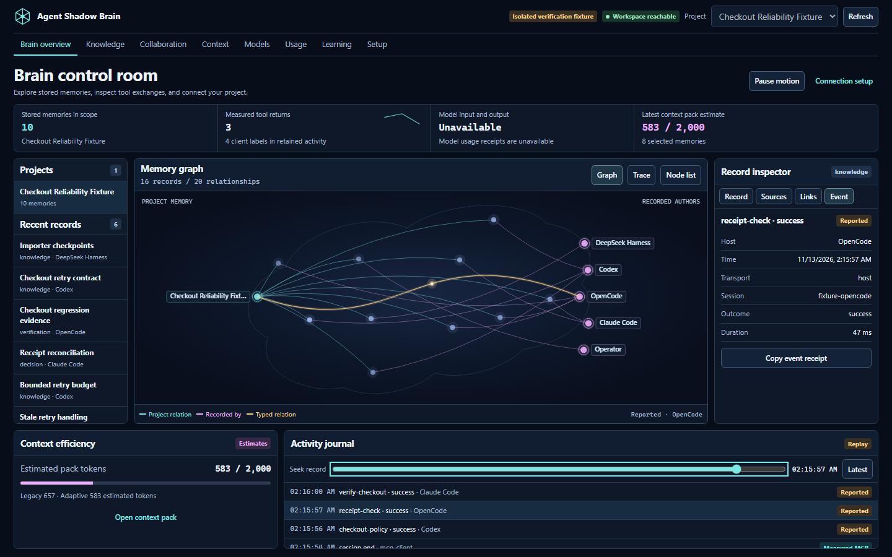

# Workspace guide

Start a project-local Brain Hub from your project directory.

```bash
shadow-brain project workspace . --port 62595
```

Open [the project Hub](http://127.0.0.1:62595/hub). Keep the process running and reuse the same directory and port after restarting. `/workspace` opens the classic memory workspace; `/live` opens detailed activity diagnostics. The shared-store `shadow-brain dash . --no-analysis` opens an all-project view. Project-local PDF review, rooms, skills, and lesson promotion require the project workspace.



## Inspect records and activity

Select a project, agent, or memory node. For keyboard navigation, open **Node list**. The inspector shows record content, recorded source references, and explicit links. **Trace** shows the retained journal. Seek an event to inspect it and copy the event receipt. **Latest** returns to incoming records. **Pause motion** and reduced-motion settings suppress moving packets.

Every graph node and relationship comes from the stored project, memory and author records. Cyan moving highlights mark fresh measured events and amber marks fresh reports when both recorded endpoints are present. Events without matching graph endpoints remain in the journal. The local workspace status, client file presence, observed tool activity, and model data each have independent evidence.

## Review and use knowledge

Use **Knowledge** to upload a PDF and inspect extracted pages. Approving a page writes a source-backed project memory. Image-only pages require OCR. You can also save explicit text and a reference, inspect project markers, or preview and apply a project skill. [Project Kit](PROJECT_KIT.md)

Use **Context** to enter a task, set a budget, compare profiles, and copy a pack. Review selected passages, reasons, and citations. The pack size is estimated. Tool timings and model token receipts are separate, and unavailable receipts stay visibly unavailable. [Context Lab](CONTEXT_LAB.md)

## Share a task and its evidence

Create or open a **Collaboration** room. Post a proposal, critique, question, decision, or handoff. Add a task and claim it before attaching a project-relative file. The task’s lease and revision control ownership. Accept the current submitted artifact and record the result with its check and evidence. A participant can acknowledge another participant’s message or artifact. These operations are shared with project-local MCP clients. [Workflow integration](WORKFLOW_INTEGRATION.md)

In **Learning**, propose a lesson from a recorded outcome. Record the baseline, candidate, controls, and evidence. Promotion is an explicit operator action. Rollback archives the promoted memory so it no longer influences normal retrieval. Use the classic workspace to manage separate task-scoped retrieval feedback. [Learning guide](LEARNING.md)

## Change runtime controls

In **Setup**, manage context packs, activity display, and activity recording. The project portal stays pinned to its project, so cross-project context is unavailable here. Automatic briefing requires a legacy analysis session. Feature changes are revisioned and persist when the local process restarts. Disabling the activity display hides journal records in the Hub. Disabling recording stops new optional telemetry. Work-room records remain available.

Setup can print native client recipes and diagnostic text. Recipes point to the selected local installation and store. To confirm the host actually uses the same project, call one of its project tools and inspect the journal. [Integrations](INTEGRATIONS.md)

[Visual guide](VISUAL_GUIDE_v7.1.4.md) · [Troubleshooting](TROUBLESHOOTING.md)
