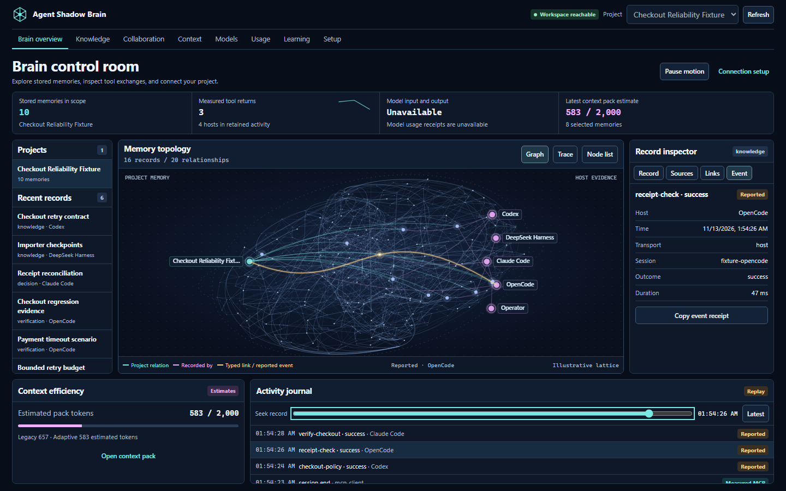

# Agent Shadow Brain 7.1.4

The local Brain Hub brings actual saved memory, project documents, collaboration, and the activity journal into one control room. Node.js 22.13+ in the 22.x line, 24.x, or 26+ is required.

## Install and open

```bash
npm install -g @theihtisham/agent-shadow-brain@latest
shadow-brain --version
shadow-brain project workspace . --port 62595
```

Check for `7.1.4`, then open [the project Brain Hub](http://127.0.0.1:62595/hub). Keep the local process running. Reuse the project directory and port after a restart. The classic workspace is still at `/workspace`; detailed activity is at `/live`. [Quickstart](../QUICKSTART.md)

## What changed

- **Control room.** The graph loads actual project, agent, and memory relationships, with a keyboard-accessible node list and record inspector. The local process reports its own health. The page retries when it loses the server, and it reopens the scope when the process instance changes.
- **PDF intake.** Project PDFs have bounded extraction, stored fingerprints, and page-level review. Approved pages become cited project memory. Image-only pages surface the need for OCR.
- **Collaboration.** Project rooms contain proposals, replies, leased task claims, artifacts with recorded digests, acknowledgements, and outcomes. The browser and configured project-local MCP clients share these records.
- **Context and skills.** Build and compare scoped packs, copy the rendered Markdown, save project knowledge, and preview and apply host-specific project skills. The classic Context Lab retains detailed retrieval explanations and memory curation.
- **Learning.** A recorded outcome can become a candidate. The operator records evaluation and explicitly promotes an eligible lesson. Rollback archives the promoted memory’s retrieval influence.
- **Setup and usage.** Persist feature changes and copy native client recipes. The Hub separates measured tool activity from explicit reports. Provider usage receipts, model identity, and cost are unavailable without host evidence. Context pack tokens are estimates.



## Verification scope

Browser checks used isolated fixture data with actual local stores and MCP calls. They exercised graph selection, context copy, PDF review, feature changes, shared work, durable retry, learning rollback, and same-port reconnect. Host file detection and local tool exchange are separate from native host confirmation. The release does not include autonomous model execution or model training.

[Visual guide](../VISUAL_GUIDE_v7.1.4.md) · [Workflow integration](../WORKFLOW_INTEGRATION.md) · [Changelog](../../CHANGELOG.md)
