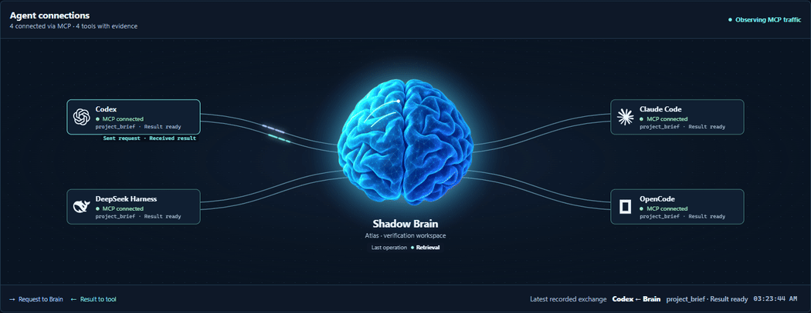
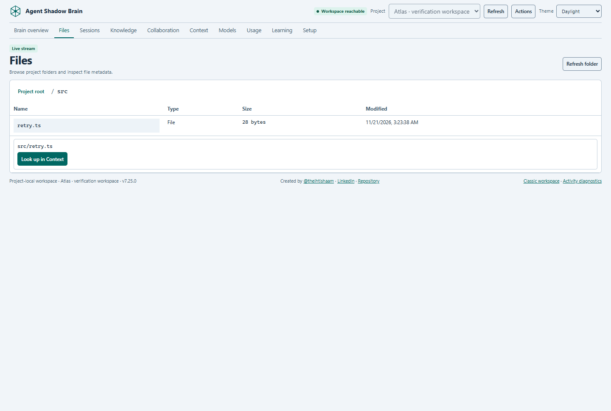

# Agent Shadow Brain 7.25.0

See the [visual guide](../VISUAL_GUIDE_v7.25.0.md) for browser captures of setup, context, usage and collaboration, plus the reproducible four-fact comparison.

## One project brain across your tools

Point the Codex, Claude Code, DeepSeek Harness and OpenCode project recipes at the same directory. Each participating client can call `project_brief` with a question and receive the latest matching project notes as cited Markdown. Each passage carries the original memory ID, so another tool can check the same evidence. Chat visibility, curation, tool participation and context budgets apply when the brief is built.

For example, save “The retry ledger allows three attempts” in Knowledge. Ask a connected client to call `project_brief` with `{"query":"retry ledger"}`. A second client pointed at the same project can retrieve the note immediately. Use a saved session checkpoint to hand off the current work as well. See the [connection recipes](../QUICKSTART.md).

The brief uses adaptive retrieval, requests at most six passages, and defaults to a 900 estimated-token budget subject to project limits. Full selection diagnostics are available through `context_pack`. Multiword searches such as “retry ledger” can also match identifiers such as `HTTPRetryLedger`.

## Follow an exchange

Open **Brain overview**. The illuminated brain represents the shared workspace. The diagram draws tool endpoints from project evidence. Solid routes indicate current reporting connections. Muted routes keep previously observed tools visible. A measured request travels toward the brain and a returned result travels back to its tool. Errors have their own result indicator. Select a tool to inspect its recorded chat, latest action, model and effort when supplied by the host. Choose an exchange to inspect its receipt.

**Usage** lets you filter retained host reports and inspect the coverage of token counts. **Context** shows the chosen passages, effective budget and estimated size. The comparison describes the assembled context. Actual model usage comes from host reports.

**Payload traffic** plots request-argument bytes below its centerline and returned text bytes above it. Select a column for the measured tool and its paired receipt. The adjacent workspace feed identifies phases reported by clients and observed file changes.

## Discover and manage project hosts

**Setup → Host connections** recognizes command and extension installation evidence for eight host families. The portal can prepare project configurations for Codex, Claude Code, OpenCode V2, Kilo Code, and current VS Code/Copilot. Cline, DeepSeek Harness, and OpenClaw have host-specific setup guides. Existing configurations needing a merge are surfaced for review. After reload or host approval, a live MCP connection appears when the host actually opens the transport. [Host documentation and compatibility](../INTEGRATIONS.md)

Enable automatic connections to recheck installed hosts while the portal is open. The project switch pauses agent-facing project memory access. An individual host’s admission switch applies on its next request. A running host may keep its transport open while access is paused. These controls use the identity declared by the client or its project launch configuration.

## Move from a file to memory

Open **Files**, choose a folder, select a file, then choose the context lookup. Its project-relative path becomes your query in **Context**. You decide when to run it. The explorer reads folder entries and metadata on demand, paginates results, and skips protected files and linked paths. The optional file activity watcher has its own setting.

Use **Actions** or **Ctrl/Cmd + K** to navigate. Right-click a graph record, tool, or exchange to see its available actions. Use **Shift + F10** on a focused item for the keyboard equivalent. The **Theme** selector offers Midnight, Daylight and High contrast. The browser remembers the choice. Reduced motion preserves the visible activity labels.

[Integration research and acceptance plan](RESEARCH_AND_PLAN_v7.25.0.md)

## Design review

| Existing surface | What informed this release |
| --- | --- |
| Brain Hub | The dark memory graph and inspector support deep inspection. The new topology puts live transport activity at the top of Overview. |
| Classic workspace and Project Kit | Light and dark workspace layouts established a daylight option for reading paths, notes and tables. |
| Live operations | Direction, timestamps and receipts distinguish measured requests from host-reported progress. |
| Advanced v6 dashboard | Its light and dark themes use dense data panels. The Brain Hub keeps detailed model and context records available on demand. |

The interconnection design follows MCP's client/server model. Each configured host asks the project server for context and chooses how to use the result. The graph measures traffic at that interface. [MCP architecture](https://github.com/modelcontextprotocol/modelcontextprotocol/blob/main/docs/specification/2025-03-26/architecture/index.mdx)
